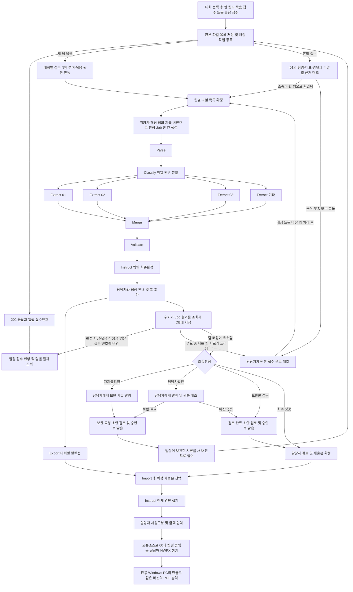

# 시상금 증빙 자동화 기획서

SW중심대학 사업단 담당자는 한 팀에서 받은 서류를 한 묶음으로 접수한다. 팀명을 몰라도 대회 안에서 ‘접수 1팀’, ‘접수 2팀’ 순으로 등록되며, 신청서에서 읽은 이름은 같은 접수번호에 표시된다. Upstage Studio 에이전트는 팀별로 정보를 추출하고 누락과 불일치를 찾는다. 문제가 발견되면 업무 현황 화면에 표시하고 팀장에게 보낼 검토 결과와 필요한 조치를 담은 메일 초안을 만든다. 담당자가 수신자와 내용을 확인하고 발송을 승인한다. 운영판에서 담당자는 자신의 PC 브라우저로 증빙을 검토하고 팀별 시상구분·지원액을 입력한 뒤 HWPX와 PDF를 내려받는다. HWPX는 오픈소스 도구로 만들고, PDF는 학교 또는 운영팀이 관리하는 전용 Windows PC의 워커가 설치된 한글로 출력한다.

이 문서는 같은 프로젝트의 다른 세션이 요구사항과 준비된 자료를 이어받기 위한 기준 문서다. 사용자와 확정한 사항, 제안된 설정, 실제로 확인한 진행 상태를 구분한다.

| 항목 | 현재 기준 |
|---|---|
| 갱신일 | 2026년 11월 10일 한국 시간 |
| 카테고리·워크스페이스와 최신 UI | 업무 카테고리 선택 → 워크스페이스 생성·선택 → 파일 첨부·검토 순서로 진입한다. 시상금 서류 검토만 활성화하고 다른 업무 5종은 회색 준비 중 카드로 표시한다. 로그인은 항상 카테고리 선택으로 이동한다. `origin/main`의 `c6f0167`(와이어프레임 PR #2)을 기반으로 `feat/ui-refresh-tour`에서 흰 사이드바·회색 배경·정리된 메뉴·업로드 탭·메일 검토 화면을 결합했다. |
| 워크스페이스 첫 사용 가이드 | 실제 버튼 주변을 강조하고 옆에 설명을 띄우는 7단계 체험형 가이드다. 새 공간 첫 진입 시 자동 시작하며 파일 첨부 메뉴·파일 선택·첨부 버튼·첨부 내역·결과 확인·메일·보고서를 안내한다. 이전·다음·가이드 종료와 다시 시작을 제공한다. 종료·진행 상태는 공간별로 기억하며 선택한 파일을 보존한다. |
| 운영 스택 | 담당자 화면은 **React**, 백엔드 API는 **Spring Boot**, 운영 DB는 **PostgreSQL**이다. 판정 작업의 대기열과 워커 배정은 PostgreSQL이 관리한다. Spring Batch는 초기 도입을 보류하고 PDF 출력은 전용 Windows PC에 배치한다. [구현계획서](docs/IMPLEMENTATION_PLAN.md#운영판-전환) |
| AWS 배포·담당자 로그인 확인 | 팀원 계정 `416775509196`, 배포 `d1110a`의 공개 주소는 `https://d3nkw8bzgv8pom.cloudfront.net`이다. 이 PC에서 `staff-a`·`staff-b`의 `임시 비밀번호` 로그인 204와 공식 set01 원본 3개의 접수·다운로드 해시 일치를 확인했다. IAM 사용자 `swax-pc-russe`는 준비됐다는 인계를 받았으나 초기 비밀번호 전달 전이므로 AWS 인증·PC 워커 연결은 대기 중이다. 로컬 한글 PDF 변환은 3파일·4쪽을 확인했고 Studio·보고서·Gmail 전체 연결은 미검증이다. [배포 프롬프트](docs/AWS_DEPLOY_PROMPT.txt) |
| AWS 시연 배치 결정 | 11월 10일 사용자는 기존 `t3.medium`(2 vCPU·4 GiB) 유지로 최종 확정했다. 같은 서버에 한글·문서 워커를 배치해 한 팀씩 처리하고, 실측으로 자원 부족과 과잉 사양을 모두 평가한다. 하향 후보·예상 절감액·처리 성능과 검증 한계도 보고하며 상향·하향 모두 임의 적용하지 않는다. 추가 서버·유료 플랜 전환도 하지 않는다. `t3.medium`은 프리티어 대상이 아니며 실제 플랜·크레딧은 미조회다. 실서비스 구성은 추후 회의에서 정한다. [후속 실행 프롬프트](docs/AWS_WORKER_MIGRATION_PROMPT.txt). 사용자가 설치 프롬프트를 팀원에게 전달했으며 실제 실행·완료 결과는 대기 중이다. |
| 1차 시연 범위 | 담당자 1명이 Windows PC 한 대에서 한 팀씩 서류를 묶어 접수하고 자동 팀번호 부여·신청서 팀명 반영·팀별 검토·팀장 메일 초안 검토·승인 발송·보완본 재검토·HWPX와 PDF 다운로드까지 진행. 11월 9일 담당자 브라우저에서 한글 문서의 본문·표·서식을 자유롭게 편집하고 수정본을 저장하는 기능을 시연 목표에 추가했다. 완료 기준은 10.1절 |
| 운영판 1차 구현 | React → Spring Boot → PostgreSQL로 대회·팀 등록, 혼합 원본 접수, 접수 내역 조회와 원본 다운로드를 구현했다. 공식 ZIP 29개 원본의 SHA-256이 다운로드 결과와 일치했고, Chrome에서 set01·02의 원본 6개를 한 번에 접수해 다시 열었다. [실행 방법](README.md#운영판-원본-접수-실행) |
| 담당자 화면 A안 | 2026년 11월 8일 A안(울산대 SW중심대학사업단 팔레트, TypeScript·Tailwind CSS·React Router)을 main에 병합했다. 같은 날 `feat/connect-review-api`에서 업무 현황·팀별 검토·팀 배정·이메일 발송·보고서 화면을 검토 서비스 API(`service/app.py`)에 연결했다. `npm run dev:service`로 검토 서비스에, `npm run dev`로 Spring Boot 접수 API에 붙는다. Windows PC에서 `npm install` 후 `npm run build`(타입 검사와 `vite build`)가 통과했다. 11월 8일에는 대역 서버로 경로·헤더·본문을 확인했다. [화면 구성](frontend/README.md) |
| 담당자 화면 디자인·검증 | 11월 9일 울산대 사업단 색상에 Apple 디자인 지침을 적용했다. 데스크톱은 사이드바에서 업무를 선택하고, 모바일은 메뉴와 팀별 목록으로 검토한다. 팀 배정·원본 접수·팀별 검토의 파일명은 16px 이상 반굵기로 표시하며, Chrome에서 320px 폭에서도 긴 파일명의 확장자까지 읽을 수 있음을 확인했다. Chrome을 실제 Windows 검토 서비스의 시험 데이터 사본에 연결해 공식 set01·02 원본 6개를 접수했다. 같은 두 팀의 기존 확정 버전에서 내려받은 HWPX(7개 구역)와 PDF(11쪽)는 서버 저장본과 각각 바이트가 일치했다. [화면 구성](frontend/README.md) |
| 담당자 접수·배정 UX | 팀 배정은 넓은 화면에서 파일 목록과 상세를 나란히 표시하고, 좁은 화면에서 뒤로가면 선택했던 파일로 키보드 포커스가 돌아온다. Chrome 시험에서 조회 재시도, 배정 근거 오류, 업로드 후 서버 저장 대기와 320~1440px 레이아웃을 확인했다. 18765에서도 미리보기가 없는 원본을 내려받아 접수 시 기록한 크기와 대조했다. [화면과 검증 방법](frontend/README.md) |
| 팀별 검토 바로가기 | 업무 현황의 팀별 판정 표에서 각 행 오른쪽의 ‘검토 열기’로 현재 제출본의 원문과 판정 근거를 확인한다. 제출본이 없는 팀에는 ‘제출본 없음’을 표시한다. |
| 서류 승인과 보고서 지급 정보 | 담당자가 현재 제출본의 서류를 승인하면 해당 팀이 보고서의 지급 정보 입력 목록에 표시된다. 보고서에 포함할 팀마다 시상구분·지원액·지급총액·세액·차인지급액을 저장한 뒤 HWPX·PDF 미리보기를 생성한다. |
| 지급 정보 입력 검증 | 11월 10일 18765에 적용했다. ‘테스트’ 대회의 가상검토팀02는 서류 승인 상태이고 지급 정보 다섯 칸이 모두 비어 있다. 별도 시험 대회에서는 각 항목을 하나씩 비웠을 때 서버가 생성을 거절했고, Chrome에서 차인지급액을 저장한 뒤 생성이 가능해졌다. 세액이 0원인 확정본의 HWPX와 PDF를 내려받았다. |
| 담당자용 판정 사유 | 업무 현황에는 보완하거나 대조할 사유를 최대 두 개까지 표시하고 추가 사유는 건수로 표시한다. 성공은 ‘보완 사항 없음’으로 표시한다. 검토 상세에서는 사유별로 해당 원본 위치를 열 수 있고, 통과한 항목과 명단·지급 정보는 필요할 때 펼친다. |
| 원문 위 검토 설명 | `재제출요청`·`담당자확인` 제출본은 원본 미리보기 위에서 저장된 Upstage 판정 사유와 검토 보고서를 읽는다. 보고서에서 문제로 명시한 필드를 한글 항목명으로 표시하고, 관측값이 비어 있다고 기록된 항목에는 ‘API 추출값 없음’을 표시한다. 설명에 판정한 제출 버전을 함께 표시한다. 11월 10일 18765에 적용했고, Chrome에서 성공 건·상세 응답 없는 과거 건·320px 폭의 설명 표시를 검증했다. |
| 워커 실행과 원본 미리보기 | 운영판 왼쪽 사이드바와 모바일 메뉴는 워커 실행 상태를 한 줄로 표시한다. 18765에서 ‘실행하기’ 버튼을 확인했다. 별도 시험 DB에서 두 브라우저 탭이 동시에 누르자 업무 워커와 로컬 PDF 워커가 한 번씩 실행됐다. 전용 출력 PC를 쓰는 설정에서는 업무 워커만 시작됐다. 원본의 기본 미리보기와 확대 보기도 18765에서 확인했다. [화면과 상태 기준](frontend/README.md#워커-상태와-문서-미리보기) |
| 판독 대기와 팀별 판정 | 팀 배정 화면의 ‘확인할 파일’에는 판독 대기부터 팀 배정이 끝날 때까지 원본이 표시된다. 배정 완료·대상 외 파일만 접힌 목록으로 이동한다. 업무 현황의 ‘처리 대기’에는 Studio 판정을 기다리거나 처리 중인 팀이, ‘정리됨’에는 현재 제출본의 성공 판정이 표시된다. 성공은 담당자 승인 전에도 ‘정리됨’으로 분류하며, 승인 여부는 ‘담당자 결정’에서 확인한다. |
| Windows 시연판 실측 | 공식 set01·02의 팀별 Studio 판정부터 HWPX/PDF 다운로드까지 검증했다. 설정 23은 두 팀의 소속 표기 차이에 `담당자확인`을, set04의 동의서 누락에 `재제출요청`을 반환했다. set04 팀장용 보완 메일은 로컬 메일함에 한 통 도착했다. 담당자 Gmail 송수신 확인은 10절에 기록했다. [실행 안내](docs/LOCAL_SERVICE.md) |
| 시연판 Studio 설정 | 11월 10일 02시 12분에 판정 워커가 같은 에이전트의 설정 51(`UPSTAGE_CONFIG_ID=51`)을 읽었다. 그 시점까지 완료된 판정 29건은 모두 설정 23으로 실행했다. |
| 추출값 전달 기준 | 11월 10일 사용자 결정으로 Upstage 추출값을 보존하고 담당자가 수정하는 구조를 적용한다. 이름이 없는 부분 행과 모든 Extract 응답·관측값·출처를 유지한다. 복수 제출본을 섞어 누락값을 채우지 않으며 유효본 확인을 표시한다. 코드 수정·검증은 10.11절에 기록했다. |
| 자동 기입값의 원천 | 11월 10일 사용자는 학생 제출서류의 자동 기입값을 Upstage 에이전트 응답에서 가져와야 한다고 명확히 했다. 10.12절의 원천 점검 후 등록 팀명·대표명·로컬 이메일·문서 유형의 대체 경로를 제거했다. 추출값이 없으면 `미확인`으로 표시하며 담당자 입력·수정과 서식용 계산값은 별도 출처로 구분한다. 수정·검증과 배포 전 상태는 10.14절에 기록했다. |
| 최종 테스트 자료 | 11월 9일 제공받은 v6 ZIP의 20세트·58문서. 성공 7팀, 담당자확인 2팀, 재제출요청 11팀이 기대값이다. [입력·정답·검수 기록](#9-준비된-테스트-자료). 이전 10세트로 얻은 Studio·서비스 실측은 당시 기록이다. |
| 운영판 담당자 접근 | 별도 Chrome 세션에서 기존 공식 접수의 같은 원본 URL을 열었다. 배정 계정은 SHA-256이 일치하는 파일을 받았고, 다른 계정은 404, 비로그인은 401을 받았다. 시험 대회에서 권한을 회수하면 로그인 중에도 다음 다운로드가 차단됐다. [인증과 권한](docs/IMPLEMENTATION_PLAN.md#담당자-인증과-대회-권한) |
| 운영판 Gmail 연결 | [18765 복귀 주소를 Google에 등록](docs/IMPLEMENTATION_PLAN.md#51-담당자-gmail-연결)한 후 Chrome에서 **Google로 연결**을 눌러 같은 탭에 실제 Google의 ‘이메일 또는 휴대전화’ 로그인 화면이 뜨는 것을 확인했다(8765 요청 0건). 승인·취소 후 Gmail 연결 화면으로 돌아오는 동작은 Google 응답 대역으로 검증했고, Windows 시연판의 발송 워커가 Spring Boot가 암호화한 시험 토큰을 읽었다. 연결 중에는 **연결 해제**를 표시한다. 해제하면 Google 발송 권한을 철회하며 담당자는 같은 화면에서 다시 연결할 수 있다. |
| 운영판 수동 배정 | 기존 공식 set01 원본을 두 담당자가 차례로 미배정 → Nextify → AutoAI로 배정했다. 원본별 이력에서 전후 팀, 로그인 계정, 사유, 변경 시각을 확인했다. 같은 요청 재전송 뒤에도 이력은 두 건이고 원본 SHA-256은 일치했다. [원본 수동 배정 API](docs/IMPLEMENTATION_PLAN.md#원본-수동-배정-api) |
| 운영판 팀별 제출본 | 후보 제외·대상 외 결정을 기록하고 관련 미배정 원본이 없는 팀부터 제출본을 확정한다. 파일 내용과 부수가 같은 묶음은 기존 버전을 사용한다. 확정 후 재배정하면 원본 목록이 바뀐 팀의 버전만 갱신한다. [팀별 제출본 확정 API](docs/IMPLEMENTATION_PLAN.md#팀별-제출본-확정-api) |
| 운영판 판정 작업 | 워커가 팀별 확정 작업을 선점하고 원본을 내려받아 Studio 실행 ID와 결과를 같은 제출 버전에 기록한다. 두 워커가 작업 한 건을 동시에 요청했을 때 한 쪽만 배정받았다. 접수 상세는 처리 중, 검토 완료와 최종판정, 처리 실패를 팀별로 갱신한다. [워커 API](docs/IMPLEMENTATION_PLAN.md#워커-판정-작업-배정과-결과-등록) |
| 운영판 판독·검토·출력 | PostgreSQL과 운영 워커를 연결했다. 공식 원본의 실제 Studio 판정, 담당자 검토, 로컬 메일 수신, 두 담당자의 HWPX·PDF와 편집본 재출력을 확인했다. [운영판 인수 기록](#106-운영판-인수-기록--2026년-11월-9일) |
| 운영판 배정·발송·인증 복구 | 원접수의 팀과 원문이 충돌하면 후보 팀의 확정을 보류한다. 신청서 대표 이메일과 등록 주소가 다르면 화면에 수신자 확인을 표시하고 팀장 안내를 초안으로 보관한다. 현재 제출본의 수신 주소를 확인한 뒤 승인한 메일을 한 통 보낸다. 인증 오류 중 보완본 접수와 키 복구 후 다음 팀의 판정 재개는 Studio 모의 응답으로 검증했다. [구현계획서와 검증 기록](docs/IMPLEMENTATION_PLAN.md#운영판-인수-결과) |
| 운영판 메일 발송 승인 | 2026년 11월 9일 18765에서 기존 발송 대기 12건을 미승인 초안으로 전환했고, 발송 완료 7건의 수신자·제목·본문이 보존됐음을 확인했다. 격리된 Chrome 시험에서는 초안을 수정해 저장하고 새로고침한 뒤 승인했다. 로컬 시험 메일함에서 수정한 내용 한 통을 확인했다. |
| 메일 수신 대상 | 2026년 11월 10일 결정으로 이메일은 팀장 보완 요청과 검토 완료 안내만 발송한다. 담당자에게는 업무 현황 화면으로 확인할 일을 표시한다. 18765에서 기존 담당자 알림 초안 19건을 종료했고, 팀장 메일 25건과 기존 발송 기록을 보존했다. 격리된 Chrome과 로컬 시험 메일함에서 담당자 메일 차단과 팀장 초안 수정·승인·단일 발송을 확인했다. |
| 소속 표기 기준 보류 | 01 지급확인서와 02 동의서에서 어떤 학부·학과·전공 표기를 같은 소속으로 인정할지는 팀 합의 후 정한다. 그때까지 Studio 프롬프트와 운영 화면의 소속 비교 규칙 변경을 보류한다. |
| 현장 확인 | 학교 전용 PC를 실제로 재부팅한 뒤 한글 자동 출력이 시작되는지와 학교 계약의 무인 자동화 이용 범위. 실제 Studio 연동은 공식 set01·02·04와 set05~09에서 확인했다. |
| 구성 프롬프트 | [Studio 구성 프롬프트](docs/STUDIO_BUILD_PROMPT.txt). 최종판정은 9.4절, 판정 후 알림은 7.1절 기준 |
| 구현계획서 | [팀별 비동기 접수·대기열·오류 처리](docs/IMPLEMENTATION_PLAN.md). 서비스 API, 재시도·재기동 규칙과 단계별 인수 시험 |

## 1 업무 배경과 목표

담당자는 여러 팀의 신청서, 동의서, 신분증·통장 사본을 받아 인적사항과 계좌정보를 대조하고 누락을 확인한다. 이후 전체 학생의 지급내역 표를 작성하고 원본 증빙을 순서대로 붙여 제출한다. 이번 해커톤에서는 이 대조·전사 작업을 줄이고, 담당자가 문제의 근거를 확인하는 일부터 팀장이 보완할 항목을 메일로 받는 일까지 연결한다.

핵심 결과는 다음과 같다.

1. 팀별 추출 정보와 검토 결과
2. 문제 서류를 확인할 수 있는 업무 현황과 담당자가 검토·승인한 팀장용 결과 메일
3. 전체 학생의 지급상세 표와 팀 대표의 지급대상자 상세내역 초안
4. 팀별 증빙 첨부 순서와 미해결 사항 목록

최종 제출물은 00번 상금 지급내역서 전체와 팀별 원본 증빙을 순서대로 결합한 편집 가능한 HWP/HWPX 및 PDF다. 00은 첫 번째 지급상세 표와 두 번째 지급대상자 상세내역을 모두 포함하는 출력 템플릿이다. Studio는 문서 분류·추출·검토·표 데이터를 맡고, 한글 양식 채움·문서 결합·PDF 출력은 서비스의 별도 문서 처리 기능이 맡는다. 한글 원본으로 확인한 출력 결과는 10.2절에, Windows 시연판에서 실제 Studio 판정부터 보고서 다운로드까지 확인한 결과는 10.4절에 기록했다.

## 2 확정된 요구사항

다음 사항은 사용자가 직접 설명하거나 후속 답변으로 확정했다.

| 구분 | 확정 내용 |
|---|---|
| 제출자 | 각 팀의 대표 또는 팀장 |
| 업로드 단위 | 기본은 한 팀에서 받은 제출 묶음 한 건이다. 담당자가 팀명을 입력하지 않아도 대회별로 `접수 N팀`을 부여한다. 신청서가 없어도 받은 서류만으로 판정한다. 다음 팀은 별도 접수하며, 기존 팀 보완·여러 팀 혼합 접수는 별도 선택지다. |
| 처리 단위 | 한 팀이 제출한 01·02·03 파일 묶음 하나가 케이스 하나 |
| 인원 정보 | 01에 대표를 포함한 팀원 전체 정보가 기입됨 |
| 신분증과 통장 | 03은 팀 대표의 증빙이며 팀 대표 정보와 대조 |
| 입력 범위 | 학생 제출·추출 입력은 01·02·03. 00은 출력 템플릿으로 별도 관리하고 최종 결과의 맨 앞에 한 번 포함 |
| 00의 첫 번째 표 | 전체 학생 한 명당 한 행. 연번, 성명, 학번(학교), 전공, 팀명, 시상구분, 지원액(원) |
| 00의 두 번째 표 | 실제 상금을 받는 팀 대표 한 명당 한 행. 4팀이면 대표 4명 |
| 두 번째 표의 열 | 연번, 성명, 학번, 전공, 주민번호, 은행명, 계좌번호, 예금주명, 지급총액, 세액, 차인지급액 |
| 주민번호 표기 | 서류에서 확인되는 마스킹 표기를 그대로 입력. 가려진 숫자를 복원하거나 추정하지 않음 |
| 시상구분과 지원액 | 문서에서 추측하지 않고 `미확인`으로 출력, 담당자가 팀별 입력 |
| 오류 통지 | 누락·불일치는 업무 현황에 표시하고 팀장 보완 요청을 초안으로 생성한다. 판독이 불확실하면 담당자가 원본을 확인한 뒤 팀장 안내 초안을 만든다. 모든 메일은 이메일 발송 화면에서 건별로 제목·본문을 수정하고 승인한 뒤 전송한다. |
| 운영 메일 | 담당자 Gmail 한 계정을 발신 주소와 관리자 알림 수신처로 사용한다. 팀장에게는 담당자가 확인한 이메일 주소 한 개로 보내며 수신 도메인은 제한하지 않는다. |
| 재제출 | 팀장이 보완한 서류를 같은 팀의 새 제출 버전으로 접수해 다시 검토 |
| 첨부 단위 | 팀별 증빙을 한 번씩 사용, 팀원 수만큼 같은 서류를 반복하지 않음 |
| 첨부 순서 | 00 전체 → 첫 팀 01·02·03 → 다음 팀 01·02·03. 두 표와 첨부에 같은 확정 팀 순서를 적용 |
| 원본 보존 | 최종 증빙에는 제출 원본 페이지를 사용하고 서명·이미지를 보존 |
| 담당자의 자료 삭제 | 대회 관리, 접수 내역, 접수 상세에서 각각 대회·묶음·원본을 삭제한다. 확정 전 함께 삭제될 팀별 판정과 지급내역서 버전·편집본을 확인한다. 확정본에 쓰인 원본을 지우면 그 판정·메일 이력과 보고서를 함께 삭제한다. 다른 팀의 독립된 결과는 유지한다. [삭제 API와 범위](docs/IMPLEMENTATION_PLAN.md#대회접수원본-삭제-api) |
| 운영판 구현 방식 | Spring Boot API가 원본 접수와 팀별 제출 버전을 관리한다. 파일 목록이 확정된 팀부터 제출 버전당 기존 Studio 판정 Job 한 건을 실행한다. 담당자는 React 화면에서 원본과 판정 근거를 대조하고 보고서를 확정·다운로드한다. |
| 운영판 문서 출력 | 오픈소스 도구로 00의 두 표를 채우고 확정 팀 순서대로 01·02·03 원본 증빙을 결합해 편집 가능한 HWPX를 만든다. 전용 Windows PC의 워커가 그 HWPX를 한글로 열어 같은 보고서 버전의 PDF를 출력한다. 담당자는 웹에서 두 파일을 받는다. |

예를 들어 4팀이면 입력 증빙은 12개이며, 최종 보고서는 00 한 개와 팀별 증빙 12개로 구성된다. 이는 문서 구성 요소 13개라는 뜻이며 13쪽이라는 뜻은 아니다. 현재 00 양식 자체가 2쪽이고 인원 증가로 표가 늘어날 수 있으므로, 총 쪽수는 `완성된 00의 전체 쪽수 + 모든 팀의 01·02·03 전체 쪽수`로 계산한다. 학생 20명이 4명씩 5팀이면 첫 번째 표는 20명, 두 번째 표는 대표 5명이며 입력 증빙은 15개다.

팀 상금을 전체 팀원에게 각각 지급하는 금액처럼 반복 합산하지 않는다. 문서 편집 시 팀명·시상구분·지원액은 팀별로 묶어 표시하거나 대표 행에만 팀 지급액을 표시한다.

## 3 프로젝트 자료

원본 자료는 아래 폴더에 보관되어 있다.

`0_RE_ [인터뷰 협조 요청] Upstage AI Agent Hackathon 프로젝트 관련 실무 인터뷰 요청_261104/`

| 자료 | 역할과 주의점 |
|---|---|
| `00. 상금 지급내역서_WAVE 2026.hwp` | 현재 폴더의 실제 출력 양식. 전체 2쪽을 채워 최종 맨 앞에 한 번 배치. 학생 제출·추출 입력에서는 제외 |
| `01. (팀별) SW수혜학생신청 및 시상금지급확의서.hwp` | 팀명, 대표·팀원 인적사항, 대표 은행·계좌, 지급 확인 및 서명 영역 |
| `02. (팀별) 수혜학생 개인정보수집이용제공동의서.hwp` | 안내문과 수혜인력 동의 작성표. 학번 칸은 없음 |
| `03. (팀장) 신분증 사본 및 통장사본_팀명(이름-홍길동).hwpx` | 대표의 신분증·통장 이미지 첨부 양식 |

원본 파일명은 그대로 유지한다. 특히 01의 실제 파일명에 있는 `확의서` 표기를 임의로 바꾸지 않는다.

01의 팀원 표는 반복 행 구조로 추출한다. 02에는 빈 행과 양식 예시, 미리 표시된 체크가 있을 수 있으므로 실제 작성된 사람만 센다. 03은 제목만 있고 증빙 이미지가 비어 있는 경우와 실제 이미지가 있으나 흐린 경우를 구분하여 확인 대상으로 남긴다.

원본 서류에 실제 개인정보가 포함될 수 있으므로 해커톤 실행에는 아래에 준비된 가상 테스트 자료를 사용한다.

## 4 처리 흐름



일괄 접수번호로 각 원본의 배정 결과를 조회하고, 팀별 접수번호로 해당 제출 버전의 판정과 발송 상태를 조회한다. 대회 전체 집계는 Export한 컬렉션에서 담당자가 확정한 제출본을 대상으로 한다. 알림·메일 발송·보완본 접수는 7.1절을 따른다.

공식 설명서는 통합 업로드로 여러 파일을 한 케이스로 묶는 기능과, 문서종별 추출 및 분할 결과 병합을 안내한다. 아래 설정은 이를 현재 양식에 적용한 설계안이며 실제 UI 연결과 출력은 테스트가 필요하다. [워크플로우 만들기](https://console.upstage.ai/ko/docs/studio/create), [노드 설정](https://console.upstage.ai/ko/docs/studio/key-features)

### 4.1 일괄 접수와 팀별 Agents API 호출

아래의 비동기 처리·폴링은 Windows 시연판의 참조 흐름이다. 운영판 API는 워커에 팀별 확정 원본을 배정하고, 워커가 반환한 원격 실행 ID와 최종 결과를 해당 버전에 저장한다. 사전 연동 시험에서 별도 등록한 파일 ID를 참조하면 403이 반환됐다. 10.3절의 공식 set01·set02는 팀별 PDF 3개를 `file_data`로 Job에 직접 첨부해 처리했다. [Upstage Job 파일 입력 방식](https://github.com/UpstageAI/upstage-extensions-hub/blob/main/skills/upstage-studio/references/jobs.md)

1. 운영판은 선택한 원본과 대회·접수번호·파일 목록·새 팀 묶음의 대회별 순번을 PostgreSQL에 함께 저장한 뒤 `202 Accepted`와 조회 주소를 반환한다. 선택한 파일의 전송이 끊기면 같은 요청으로 다시 전송한다. Windows 시연판은 접수와 배정 작업을 SQLite에 기록해 후속 처리를 시작한다.
2. 새 팀 묶음은 접수 출처로 팀이 정해져 있으므로 01이 없어도 읽을 수 있는 실제 원본으로 판정한다. 예를 들어 02·03만 올려도 신청서를 기다리지 않는다. 혼합 접수는 4.3절의 기준에 따라 파일을 배정한다. 그 팀에 속할 수 있는 미배정 파일이 남아 있으면 해당 팀은 배정을 기다린다. 목록이 확정되면 실제로 받은 파일을 모두 담아 팀별 제출 버전을 만든다. 01·03만 접수된 것이 확인된 팀은 두 파일로 02 누락을 검사한다.
3. `POST /v2/responses`의 `model`에 Studio Agent ID를 넣고, `input[0].content`에 해당 팀 제출 버전의 검토용 PDF만 담아 판정 Job 한 건을 생성한다. 작은 PDF 시연은 10.3절에서 성공한 원래 파일명과 `file_data` 직접 첨부 경로를 사용한다. 별도 파일 등록 경로는 `file_id` 접근 권한을 확인한 뒤 사용한다. `config_id`에는 검증한 버전을 지정하고, 응답의 `id`를 팀별 접수번호에 연결해 `job_id`로 저장한다. 생성 응답이 끊기면 실행 이력에서 기존 Job을 먼저 찾는다. [작업 생성 명세](https://console.upstage.ai/api/agents/jobs/create-job) · [Studio 실행 이력](https://console.upstage.ai/ko/docs/studio/monitoring)
4. 워커는 `GET /v2/responses/{job_id}`로 상태를 조회해 유효한 추출값·최종판정·근거를 DB에 저장한다. 운영판 브라우저는 `GET /api/operations/submissions/{id}`에서 대기·처리·완료 상태와 결과를 읽는다. 창을 닫아도 처리는 계속되고 다시 열면 기존 접수로 돌아온다. 팀장 메일은 7.1절의 문서 판정과 담당자 확인 시점을 따른다. 공개 Agents API 명세에서 완료 웹훅 URL 설정은 확인되지 않아 1차 서비스는 워커의 폴링으로 동작하도록 설계한다. [작업 생성 명세](https://console.upstage.ai/api/agents/jobs/create-job) · [작업 조회 명세](https://console.upstage.ai/api/agents/jobs/retrieve-job)

대상 워크플로우의 **더보기(⋯) → 코드**에서 Agent ID와 Config ID를 확인한다. 키는 해당 조직의 **설정 → 조직 → API 키**에서 관리한다. 백엔드 환경 변수 `UPSTAGE_API_KEY`에서 읽어 `Authorization: Bearer <API 키>` 헤더로 전달하고, 브라우저·소스 저장소·로그에는 키를 노출하지 않는다. 확인한 공개 문서에는 `workflows:execute`라는 필수 스코프가 명시돼 있지 않다. 해당 조직 키로 파일 업로드·작업 생성·조회를 수행하는 것을 첫 연동 시험으로 삼는다. [Studio 버전과 배포](https://console.upstage.ai/ko/docs/studio/deployment) · [Studio API 키 안내](https://console.upstage.ai/ko/docs/studio) · [작업 생성 인증 명세](https://console.upstage.ai/api/agents/jobs/create-job)

### 4.2 여러 팀이 대기하거나 처리가 실패한 경우

Windows 시연판은 PC 한 대에서 **실행 가능한 팀 묶음을 접수 순서로 골라 Upstage Job을 한 건씩** 실행한다. 담당자 검토나 팀장 답변을 기다리는 동안에는 다음 팀을 처리한다. 같은 팀의 동일 묶음을 다시 올리면 기존 접수번호를 보여주고, 내용이 바뀐 보완본에는 새 버전을 부여한다. 한 묶음에 두 번 제출된 동의서는 두 건 모두 검토해 중복 제출을 찾아낸다.

담당자 화면에는 어느 팀이 기다리는지, 어떤 파일의 어느 단계에서 문제가 났는지, 무엇을 하면 되는지를 표시한다. 조회 중 네트워크가 끊기면 같은 Job을 간격을 늘려 다시 조회한다. 손상 파일은 교체를 안내하고, 인증·크레딧 문제는 담당자가 해결한 뒤 대기열을 재개한다. 장기 실행과 생성 여부가 불분명한 Job은 이력 확인 대상으로 남긴다. 접수 기록과 실행 ID가 디스크에 저장되므로 PC 재시작 후에도 중단된 단계부터 복구한다. 구체적인 시간 제한, 로그 항목, 팀장 메일의 중복 방지 기준은 [서비스 구현계획서](docs/IMPLEMENTATION_PLAN.md)에 있다.

### 4.3 혼합 접수에서 파일명에 팀명이 없을 때와 팀 배정 기준

새 팀 묶음은 접수할 때 팀 ID를 만들고 유지한다. Studio가 해당 제출본의 01에서 팀명을 읽으면 화면에 `접수 N팀 · 실제 팀명`으로 표시한다. 01이 없거나 팀명이 판독되지 않으면 `접수 N팀`을 유지한다. 이름이 같아도 다른 묶음을 합치지 않는다. 보완은 기존 팀의 제출본에서 시작하며 새 팀번호를 발급하지 않는다.

혼합 접수에서는 같은 대회 안에서 먼저 01 신청서의 **본문 팀명·대표 성명·전체 팀원 명단**을 읽어 기준을 만든다. 기존 접수와 팀명·대표가 일치하면 내부 팀 ID를 재사용한다. 처음 보는 팀은 다른 신청서나 기존 접수와 충돌하지 않을 때 새 팀 ID를 부여한다. 모든 01을 읽은 다음 02·03을 비교하므로 파일을 고른 순서는 결과에 영향을 주지 않는다. 파일명에 팀명이나 서류 번호가 없어도 접수한다.

| 들어온 파일과 근거 | 팀을 정하는 방법 |
|---|---|
| 팀장이 보낸 원래 제출 묶음을 담당자가 확인해 팀을 지정함 | 해당 팀에 배정한다. 파일명이 `동의서.pdf`여도 된다. 신청서 본문이나 다른 명확한 소속 근거가 지정한 팀과 충돌하면 원본 확인으로 넘긴다. |
| 혼합 업로드의 01 신청서 | 본문 팀명과 대표를 함께 읽어 기준 팀에 연결한다. 같은 이름의 팀이 둘 이상이거나, 같은 팀명에 대표가 다르거나, 팀명·대표를 읽을 수 없으면 담당자가 기존 접수와 원본을 대조한다. |
| 02 동의서에 팀원 전원이 작성함 | 서로 다른 작성자가 두 명 이상이고, 작성된 모든 행의 성명과 인원수가 한 팀의 01 전체 명단과 정확히 일치하며 같은 대회에 그 성명의 동명이인이 없으면 배정한다. 빈 행과 양식 예시는 제외한다. 학부·학과 표기는 두 문서의 원문 그대로 둔다. |
| 02에 일부 팀원만 있거나 동명이인이 있음 | 서로 다른 작성자 두 명 이상을 각각 `성명+학과`로 대조해, 작성된 모든 행이 한 팀의 01에만 대응하면 배정한다. 작성자가 한 명이면 정확한 팀명과 그 사람의 성명·학과를 함께 확인한다. 근거가 부족하거나 겹치면 담당자가 원접수를 대조한다. |
| 혼합 업로드의 03 대표 증빙 | 파일명 또는 본문에 명시된 팀명과 신분증 성명이 01의 팀명·대표와 함께 일치하면 배정한다. 팀명 없이 대표 이름만 보이면 동명이인이 없어 보여도 후보로만 표시한다. 예금주·계좌번호는 소속을 정하는 데 쓰지 않고 배정 뒤 01과 대조한다. |
| 01이 없고 02·03만 있음 | 기존 접수나 팀장이 보낸 원래 묶음으로 소속을 확인할 수 있으면 해당 팀에 배정하고 01 누락을 검토한다. 확인할 출처가 없으면 미배정으로 남겨 담당자가 원접수를 찾는다. |
| 잘못 적힌 팀명, 상충하는 근거, 판독 곤란, 두 팀 서류가 한 파일에 섞임 | `팀 배정 확인` 목록에 원본·후보 팀·일치하거나 충돌한 근거를 표시한다. 담당자가 원래 접수 경로와 대조해 배정한다. 한 파일에 두 팀이 섞였으면 팀별 원본을 확보할 때까지 보류한다. |

자동 배정에는 대회 안에서 후보가 한 팀이고 근거가 서로 일치해야 한다. 파일명의 팀명은 구분된 전체 표기를 비교한다. 비슷한 팀명, 폴더명, 업로드 순서, 남은 빈자리만으로 소속을 정하지 않는다. 담당자가 배정을 바꾸면 파일과 변경 전후 팀, 근거, 처리자를 기록한다.

**신청서에 다른 팀명을 적은 경우의 처리안(set04)**

1. 이번 시연에서 담당자가 확인한 제출 팀은 `4팀 · 김종인`이고, 01 신청서에 적힌 팀명은 `3팀`이다. 실제 `3팀 · 박기탁`의 서류와 구별해야 한다. 충돌이 발견되면 담당자에게 먼저 알리고 팀장 안내는 보류한다.
2. 담당자는 대회 참가 명단의 팀명·대표와 팀장이 보낸 원래 접수 메일 또는 제출 기록을 대조한다. 4팀 것으로 확인한 원본에 공식 팀, 01에 적힌 팀명, 확인 근거를 함께 기록한다. 원본은 그대로 보관한다. 3팀과 무관한 것으로 확인한 파일은 3팀의 판정을 막지 않는다.
3. 담당자는 웹 편집기에서 01 신청서의 사본을 열고 본문의 `3팀`을 `4팀`으로 고쳐 수정본으로 저장한다. 담당자 정정으로 처리할 수 있는 항목이면 팀장은 빠진 02만 제출한다. 제출자 확인이나 서명이 필요한 경우에는 01 수정본 확인과 02 제출을 같은 메일로 요청한다. 채택한 01·02와 기존 03을 새 제출 버전으로 재판정하고, 승인된 버전을 보고서에 반영한다.

팀 배정 확인과 팀별 검토의 **문서 미리보기**는 해당 파일에 저장한 최신 HWPX 수정본을 먼저 연다. **미리보기 버전**에서 접수 원본이나 이전 수정본을 선택하고 **수정본 내려받기**로 선택한 HWPX를 받을 수 있다. 체크리스트의 근거를 누르면 해당 제출 버전에서 판정에 사용한 원본 쪽을 연다. 저장한 수정본을 다음 판정에 쓰려면 담당자가 **보완본 접수**에서 채택한다.

**미배정과 서류 누락을 구분한다.** `동의서.pdf`가 A팀 또는 B팀 것일 수 있으면 두 팀 모두 02 누락 안내를 보류한다. 후보조차 좁힐 수 없으면 같은 일괄 접수에서 소속 가능성을 배제하지 못한 팀을 보류한다. 원래 접수 목록으로 관련이 없다고 확인한 팀은 먼저 진행한다. 배정이 끝나 실제로 02를 받지 않은 팀만 업무 현황의 확인할 일과 팀장 보완 메일 대상이 된다. 파일명에 팀명이 없다는 이유만으로 학생에게 메일을 보내지 않는다.

이전 10세트 시연 자료에서는 Nextify와 AutoAI의 동의서 작성자가 각각 3명·4명이었고, AutoAI의 증빙 사본 파일명이 `01_`로 시작했다. v6의 set05에는 C 파일명으로 제출된 동의서가 있다. 본문으로 문서 유형을 구분하고, 소속 근거가 대표 이름뿐이면 담당자가 원접수를 확인한다.

### 4.4 담당자 화면에서 하는 일

| 단계 | 화면에서 하는 일 |
|---|---|
| 문서 업로드 | 대회를 선택하고 한 팀의 서류를 모아 올린다. 접수 상세에 `접수 N팀`이 뜨며, **다음 팀 서류 접수**로 다른 묶음을 올린다. 혼합 접수를 선택한 경우에만 소속이 모호한 원본을 별도 배정한다. |
| 팀별 확인 | 팀을 선택해 접수한 01·02·03, 실제 누락·중복, 처리 상태, 검토 결과와 메일 발송 여부를 본다. 보완본은 같은 팀의 새 제출 버전으로 연결한다. |
| 서류 검토 | 왼쪽에 원문 미리보기, 오른쪽에 체크리스트를 둔다. 항목을 누르면 해당 파일의 쪽·행을 연다. 서류 전체가 빠진 항목은 그 팀의 확정 접수 목록을 보여준다. |
| 결과 확인·보완 안내 | `성공`은 증빙 검토 통과다. `재제출요청`은 확인된 사유를 묶어 즉시 담당자에게 알리고 팀장 보완 요청 초안을 만든다. `담당자확인`은 원본 대조 후 ‘이상 없음’ 또는 ‘보완 필요’를 기록할 때 팀장에게 결과 안내 초안을 만든다. 최초 정상 제출은 예외 메일 0통이다. |
| 보완본 재검토 | 교체·추가한 서류로 다시 검토한다. 담당자는 해소된 사유와 남은 항목을 보고, 보완본이 통과하면 팀장은 검토 완료 메일을 받는다. |
| 제출본 확정·결과 생성 | 담당자가 팀별 버전·순서·시상구분·지원액을 확인하고, 00의 두 표와 각 팀의 01→02→03 원본이 한 번씩 붙은 보고서를 미리 본다. 확정한 편집용 HWPX와 그 파일에서 만든 PDF를 내려받는다. |

### 4.5 사용자별 업무 시나리오

팀원은 자기 정보를 작성하고, 팀장은 팀 서류를 모아 대회에서 안내한 기존 제출 경로로 보낸다. 웹에 로그인해 접수·검토·보고서 확정을 수행하는 사람은 사업단 담당자다. 다음 시나리오는 가상 서류와 현재 구현된 Upstage Studio 판정을 기준으로 한다.

#### 팀원 · 내 정보와 동의가 빠졌을 때

팀원은 01 지급확인서의 자기 정보와 서명을 확인하고 02 동의서에 동의 표시와 서명을 한다. 예를 들어 01에는 세 명이 있는데 02에는 두 명만 작성했다면, 팀장이 보완 안내를 받는다. 빠진 팀원은 자기 행을 작성해 팀장에게 돌려준다. 팀원 개인의 수정도 팀장이 모아 같은 팀의 보완본으로 제출한다.

#### 팀장 · 제출한 서류 중 동의서 한 부를 빠뜨렸을 때

1. 팀장은 전체 팀원이 기재된 01, 팀원들의 02, **대표 본인의** 신분증·통장 사본인 03을 준비한다. 이 사례에서는 실수로 01과 03만 담당자에게 보낸다.
2. 팀 배정이 끝나고 02 누락에 대한 안내를 담당자가 승인하면 팀장은 보완 요청 메일 한 통을 받는다. 메일에서 자기 팀과 제출 차수, `접수 목록 02 미제출`, 해야 할 일을 확인한다. 신분증·통장 사본과 주민번호·계좌번호는 메일에 포함하지 않는다.
3. 팀장은 빠진 02만 기존 제출 경로로 보낸다. 담당자가 **보완본 접수**에서 02를 추가하면 기존 01·03을 포함한 새 버전이 만들어진다. 보완본 판정이 `성공`이면 팀장은 검토 완료 메일 한 통을 받는다. 같은 버전의 판정 결과를 다시 처리해도 같은 안내는 한 통으로 유지된다. [보완 접수 화면](frontend/src/pages/intake/Upload.tsx) · [실제 발송 문구](operations/delivery.py)

#### 사업단 담당자 · 여러 팀 서류를 한꺼번에 받아 지급내역서를 만들 때

1. **팀명을 몰라도 접수한다.** 담당자가 대회를 선택한 뒤 **원본 접수 → 새 팀 묶음 접수**에서 한 팀이 보내온 HWP·HWPX를 올린다. 다음 묶음은 **다음 팀 서류 접수**로 올린다. 업무 현황에서 팀별 결과를 확인한다. 01에서 팀명을 읽으면 같은 팀번호 옆에 이름이 나타나고, 01이 없으면 임시명 그대로 누락 판정을 확인한다.
2. **혼합 접수에서 소속이 모호한 파일을 정리한다.** 이름이 똑같은 `동의서.hwp` 두 부도 작성자 명단이 각각 한 팀의 01과 일치하면 자동 배정된다. 혼합 접수한 03에 팀명 없이 대표 이름만 있으면 담당자가 **팀 배정 확인**에서 원래 받은 묶음과 대조해 팀과 근거를 기록한다. 미배정 파일이 속할 가능성이 있는 팀은 누락 판정과 안내를 기다리고, 소속이 확정된 다른 팀은 먼저 판정을 진행한다. [팀 배정 기준 코드](service/documents.py) · [팀 배정 화면](frontend/src/pages/Assign.tsx)
3. **판정에 맞춰 행동한다.** 팀별 검토 화면의 체크리스트에서 원본의 쪽·행을 연다. 서류 전체가 빠졌을 때에는 **확정 파일 목록 보기**로 접수한 원본을 확인한다. [팀별 검토 화면](frontend/src/pages/TeamReview.tsx) · [판정별 알림 생성](backend/src/main/resources/db/migration/R__workflow_operations.sql)

   | 담당자가 본 상황 | 담당자의 행동과 팀장이 받는 안내 |
   |---|---|
   | `성공` · 최초 제출이 자동점검을 통과함 | 담당자는 원본과 결과를 검토하고 **승인**한다. 팀장은 추가 조치 없이 제출을 마친다. 최초 성공의 자동 안내는 0통이다. |
   | `재제출요청` · 배정이 끝난 팀에 02가 빠졌거나 01·03의 계좌번호가 선명하게 읽히는데 서로 다름 | 서비스가 업무 현황에 확인할 일을 표시하고 팀장 보완 요청 초안을 만든다. 담당자는 **이메일 발송**에서 팀장 수신자와 안내 문구를 검토한 뒤 **승인 후 발송**을 누른다. |
   | `담당자확인` · 03 통장 사본이 흐림 | 먼저 담당자에게만 알린다. 담당자는 01과 03을 열어 원본에서 일치가 확인되면 **승인**, 여전히 판독이 어려우면 **보완 필요**와 보완 항목을 선택하고 대조 근거를 기록한다. 그 뒤 팀장은 검토 완료 또는 선택한 항목의 증빙 보완 안내를 한 통 받는다. |
   | `수신자 확인 필요` · 02가 누락된 팀의 등록 이메일과 01의 대표 이메일이 다름 | 담당자는 원접수에서 주소를 확인해 현재 제출본에 저장하고, 팀장 안내 초안을 별도로 승인한다. [수신 주소와 검토 결론 저장](backend/src/main/java/kr/swax/intake/ReviewDecisions.java) |

4. **보고서를 확정한다.** 서류를 승인하면 최신 제출본이 **보고서**에 표시된다. 담당자는 편철할 팀과 순서를 고르고 팀별 지급 정보 다섯 항목을 저장한다. **미리보기 생성**으로 00 첫 표의 전체 학생과 둘째 표의 팀 대표, 이어지는 각 팀의 01·02·03 원본을 대조한다. **이 버전으로 확정**을 누르고 같은 버전의 편집용 HWPX와 제출용 PDF를 받는다. 한글에서 수정했다면 편집한 HWPX를 다시 올려 새 PDF를 확인하고 확정한다. [보고서 화면](frontend/src/pages/Report.tsx) · [보고서 확정 조건](backend/src/main/java/kr/swax/intake/AwardReports.java)

#### 시스템 운영자 · 공동 담당자를 배정하거나 처리가 멈췄을 때

운영자는 담당자 계정을 만들고 해당 대회 권한을 부여한다. 예를 들어 인수인계 때 후임에게 권한을 주면 후임은 그 대회의 원본과 팀별 검토를 열고, 승인된 제출본으로 자기 보고서를 생성·확정할 수 있다. Studio 인증 오류로 판정이 멈추면 운영자는 서버의 인증 설정을 복구한다. 그동안 담당자는 새 원본과 보완본을 계속 접수할 수 있다. 처리가 재개되면 현재 유효한 제출본의 판정에 따라 학생 안내가 이어진다. [계정·대회 권한 관리](README.md#담당자-계정과-대회-권한) · [인증 복구 검증](docs/IMPLEMENTATION_PLAN.md#운영판-인수-결과)

#### 공식 자료로 보여줄 시연 순서

1. Nextify(set01)와 AutoAI(set02)의 여섯 파일을 섞어 접수한다. 이름이 같은 동의서 두 부가 각각 3명·4명의 팀으로 배정된다. 두 팀은 정상 기대 사례다. 실제 Studio 설정 23에서는 소속 표기 차이로 `담당자확인`이 나왔고, 담당자가 원본을 대조해 각각 승인했다.
2. set04의 기존 시연 접수본에는 `3팀`이라고 적혀 있고 02가 빠져 있다. 기존 인수 시험에서는 02 누락에 대한 담당자 알림과 팀장 보완 요청이 로컬 시험 메일함에 각각 한 통 도착했다. 11월 10일 후속 시연에서는 담당자가 팀명을 정정한 01 한 장으로 보완 접수해 4팀 자동 배정, 실제 재판정, 메일 초안 생성까지 확인했다. [운영판 인수 기록](#106-운영판-인수-기록--2026년-11월-9일)
3. 승인한 Nextify와 AutoAI를 선택해 보고서를 확정한다. 00의 **학생 7명·대표 2명**과 **PDF 11쪽**(지급내역 2쪽, 증빙 9쪽)을 확인한다.

흐린 통장 사본(set06)의 기대 판정은 `담당자확인`이다. 11월 9일 설정 23이 실제로 반환한 `재제출요청`의 근거는 10.6절에 기록했다. [운영판 인수 기록](#106-운영판-인수-기록--2026년-11월-9일) · [공식 자료 인수 시험](tests/test_operations_acceptance.py)

## 5 팀별 증빙 검토 워크플로우

초기 설계명은 `시상금_팀별_증빙검토`다. 서비스가 팀 배정을 마친 제출 버전 하나를 기존 에이전트의 한 케이스로 넘긴다. Studio의 Classify는 그 안에서 본문의 양식과 작성 내용을 보고 01·02·03·기타를 구분한다. 누락·중복 검사는 팀별로 확정한 원본 목록을 기준으로 한다.

| 단계 | 설계 설정 |
|---|---|
| Parse | 자동 모드, OCR 강제, 한국어, 위치 정보 켬. 인식이 어려운 샘플은 고급형·DPI 300으로 비교 시험 |
| Classify | 문서 분할 후 분류, 파일 단위 분리. 여러 페이지의 02를 한 문서로 유지 |
| Extract 01 | 프로그램·팀명, 대표 정보, 전체 팀원 테이블 |
| Extract 02 | 실제 작성자의 인적사항, 동의 표시, 서명 확인 상태 |
| Extract 03 | 신분증 성명·마스킹 주민번호 표기, 예금주, 은행명, 계좌번호, 증빙 확인 사항 |
| Extract 기타 | 예상 밖 문서의 제목과 설명 |
| Merge | 네 경로의 결과를 같은 팀 케이스 안에서 합침 |
| Validate | UI에서 표현 가능한 고정 조건 검사 |
| Instruct | 최종판정은 `enum`·`reason`을 출력. 후속 노드에서 담당자용 근거, 팀장용 안내, 표 초안을 작성 |
| Export | 대회별 컬렉션에 결과 저장 |

Classify의 문서종은 다음과 같다.

| 문서종 키 | 분류 기준 |
|---|---|
| `application_01` | 수혜학생 신청 및 시상금 지급 확인서. 프로그램명, 팀명, 대표·팀원 정보와 지급 확인 내용 |
| `consent_02` | 개인정보 수집·이용·제공 안내와 수혜인력 동의 작성표 |
| `identity_bank_03` | 팀 대표의 신분증 사본과 통장 사본 첨부 문서 |
| `other` | 위 세 종류에 해당하지 않는 문서. 결과에서 조용히 제외하지 않고 확인 대상으로 남김 |

기본 구성에는 Match를 넣지 않는다. 이번 범위에는 별도 수상결과표나 기준 명부와의 연결이 없으며, 한 팀의 증빙은 이미 같은 케이스에 묶여 있다.

## 6 추출 스키마

일반 항목은 String이며 목록을 끈다. 반복 인원은 그룹 테이블로 구성한다. 이름 배열과 학번 배열을 각각 만들어 사람 간 대응이 끊어지지 않도록 한다.

| 노드 | 필드 | 설명 |
|---|---|---|
| 01 | `program_name` | 프로그램명 |
| 01 | `team_name` | 작성된 팀명 |
| 01 | `representative_name` | 팀 대표 성명 |
| 01 | `representative_email` | 01의 **팀 대표** 행 `E-mail`. 접수 시 수신자를 확인할 때 쓰는 후보 주소 |
| 01 | `representative_bank` | 대표 은행명 |
| 01 | `representative_account` | 대표 계좌번호 |
| 01 | `signature_review_notes` | 담당자가 확인할 서명 위치와 누락 의심 사항. 자유 서술 보조 필드 |
| 01 | `members` | 대표를 포함한 실제 팀원 그룹 테이블 |
| 01 테이블 | `name`, `student_id`, `school`, `major`, `role`, `birth_date` | 성명, 학번, 학교·소속, 전공, 대표 또는 팀원, 생년월일. 00에 없는 생년월일 열을 임의로 추가하지 않음 |
| 02 | `consent_members` | 실제 동의서 작성자 그룹 테이블 |
| 02 테이블 | `name`, `major` | 성명과 학과. 학번을 생성하지 않음 |
| 02 테이블 | `collection_consent` | 개인정보 수집·이용 동의 표시 |
| 02 테이블 | `identifier_consent` | 고유식별정보 처리 동의 표시 |
| 02 테이블 | `third_party_consent` | 제3자 제공 동의 표시 |
| 02 테이블 | `signature_state` | 서명 흔적 확인 상태 |
| 03 | `id_name` | 신분증에 기재된 성명 |
| 03 | `id_number_display` | 대표 신분증에 실제 보이는 주민번호 표기. 하이픈과 마스킹을 보존 |
| 03 | `account_holder` | 통장 예금주 |
| 03 | `bank_name` | 통장 은행명 |
| 03 | `account_number` | 통장 계좌번호 |
| 03 | `evidence_issue` | 빈 첨부란, 잘린 이미지, 판독 어려움 등 |
| 기타 | `document_title`, `description` | 예상 밖 문서의 제목과 설명 |

동의 표시 값은 `표시됨 / 비어 있음 / 확인 필요`, 서명 상태 값은 `서명 흔적 있음 / 누락 의심 / 확인 필요`로 요청한다. 이는 추출 결과의 표기 기준이며 서명의 진위나 법적 효력을 판정하는 기능이 아니다.

계좌번호 원문을 보관하고 비교할 때만 양쪽 문서에서 공백·하이픈을 제거한다. 앞자리 0을 보존하고 학번과 주민번호 표시값도 String으로 유지한다. 의도된 주민번호 마스킹 자체는 오류가 아니다. 성명·학과·은행명을 근거 없이 비슷한 이름으로 수정하지 않는다. 문서에 없는 정보와 읽기 어려운 값은 추측하지 않는다.

`signature_review_notes`는 자유 서술 보조 필드다. 현재 JSON 정답지에는 이 항목의 고정 정답 문자열이 없으며, 추가하더라도 기존 핵심 추출 키와 행 구조는 유지한다.

## 7 검증과 담당자 확인

| 검사 | 기대 조건 | 실패 시 처리 |
|---|---|---|
| 문서 구성 | 01·02·03 각각 한 건 | 누락 또는 중복 사유 표시 |
| 예상 밖 문서 | other 없음 | 담당자 확인 |
| 대표 필수 정보 | 성명·은행·계좌번호 존재 | 누락 항목 보완 |
| 대표 신분증 | 01 대표 성명과 03 신분증 성명 일치 | 원본값과 차이 표시 |
| 예금주 | 01 대표 성명과 03 예금주 일치 | 원본값과 차이 표시 |
| 계좌번호 | 정규화한 01·03 계좌번호 일치 | 양쪽 숫자가 분명하고 서로 다르면 재제출요청, 일부를 읽기 어려우면 담당자확인 |
| 팀원 필수 정보 | 실제 인원의 성명·학번·전공 존재 | 대상자와 누락 항목 표시 |
| 동의서 인원 | 01 명단과 02 작성자 집합 대응 | 누락·추가·중복 인원 표시 |
| 서명 | 확인할 흔적과 위치 확보 | 시각적 확인이 필요하면 담당자에게 안내 |

Validate에서 표현 가능한 조건을 우선 설정한다. 분류별 문서 수나 그룹 테이블 비교가 실제 UI에서 제공되는지는 확인해야 한다. 복잡한 행별 대응과 명단 집합 대조는 Instruct에 맡기되 담당자가 근거를 확인한다.

01과 02의 명단은 행 순서가 달라도 같은 사람일 수 있다. 02에 학번이 없으므로 성명·학과로 대조하며, 동명이인이나 표기 차이를 확실히 해소할 수 없으면 `담당자확인`으로 남긴다. 인원 수가 같다는 사실만으로 명단이 일치한다고 판정하지 않는다.

초기 구성안의 Instruct 결정값은 `자동점검 통과 / 보완 필요 / 담당자 확인 필요`였다. 사용자가 후속 제공한 최신 채점 규격은 `최종판정` Instruct의 `enum`과 `reason` 두 키이며, `enum`은 `성공 / 담당자확인 / 재제출요청`을 사용한다. 최신 V0 정답에는 초기 결정값을 사용하지 않는다. 상세 기준과 정답 상태는 9.4절을 따른다. 성공은 증빙 검사 통과이며 담당자의 제출 확정이나 지급 승인을 대신하지 않는다. 시상구분·지원액 미확인은 담당자 입력 대기이고 학생 오류가 아니다.

불일치가 발견되어도 어느 원본값이 정답인지 자동 선택하지 않는다. 모든 문서에 같은 잘못된 정보가 적혀 있는 경우에는 별도의 확정 명부 없이 진위를 판정할 수 없다.

Studio의 결과 수정과 원본 서류 수정은 다르다. 원본의 오기입은 보완된 제출본을 받아 교체한다. UI에서 추출값을 수정했을 때 후속 노드와 Export 결과가 갱신되는 방식도 실제 실행으로 확인한다. [결과 검토 안내](https://console.upstage.ai/ko/docs/studio/feedback-loop)

### 7.1 문제 서류 알림과 메일 발송 승인

팀 배정과 제출 목록이 확정된 뒤 문제가 발견되면 담당자(관리자)의 검토 화면에 알림을 띄운다. 알림에서 해당 팀과 제출 버전, 문제 항목, 원본의 쪽·행을 찾아볼 수 있게 한다. 필수 서류 전체가 빠진 경우에는 접수한 파일 목록을 근거로 보여준다. 접수 중의 `팀 배정 확인`은 담당자 전용 상태다. 검토 중 다른 팀의 자료가 드러나면 해당 팀들의 발송·최종 집계를 보류하고 4.3절에서 소속을 바로잡은 뒤 현재 버전의 결과만 안내한다.

| 판정과 사례 | 담당자 처리 | 팀장 안내 초안에 담을 내용 |
|---|---|---|
| `재제출요청` · 계좌 불일치(set03), 02 누락(set04), 02 중복과 03 누락(set05), 동의 표시·학번·서명·명단 누락(set07~10) | 제출본에서 확인된 사유를 한 건의 알림으로 받는다. | 보완할 서류, 문제 위치, 수정 방법과 재제출 경로를 한 통의 초안에 담는다. |
| `담당자확인` · 흐린 통장 사본(set06), 동명이인, 다른 팀 자료 혼재 | 즉시 알림을 받고 원본을 대조해 화면에 ‘보완 필요’ 또는 ‘이상 없음’을 기록한다. | 원본 확인이 끝나면 **검토 결과를 담은 초안 한 통**을 만든다. 예를 들어 set06은 원본에서 계좌 일치를 확인하면 추가 제출이 없음을 알리고, 원본도 읽기 어려우면 선명한 03 사본을 요청한다. |
| `성공` · 최초 정상 제출(set01·02) 또는 보완본의 재검토 통과 | 정상 건은 제출본 확정 절차로 넘기고, 보완 건은 기존 문제를 해결 처리한다. | 보완 요청을 받았던 팀에는 증빙 검토 완료를 알린다. 최초 정상 건의 예외 알림은 0건이다. |

접수할 때 담당자는 대회·팀별로 팀장 이메일 한 개를 확인한다. 01이 있으면 `팀 대표` 행의 `E-mail`을 후보로 표시한다. 01 자체가 빠져도 이미 확인한 접수 주소가 있으면 그곳으로 안내한다. 주소가 없거나 불분명하거나 접수 정보와 충돌하면 담당자에게 `수신자 확인 필요`로 알리고 발송을 보류한다. 팀장 주소를 확인한 뒤 **이메일 발송 → 승인 대기 → 초안 검토**에서 기존 안내 문구를 편집한다. **초안 저장**으로 수정을 보관하고 **승인 후 발송**으로 해당 주소와 문구를 확정한다. 2026년 11월 10일부터 이메일은 팀장 안내만 발송한다. 담당자 본인에게 보내는 알림 메일은 생성하지 않으며 기존 미발송 알림도 발송 대상에서 제외한다.

메일에는 팀명, 증빙 검토 결과, 확인된 문서 번호·쪽·항목, 팀장이 할 일과 기존 제출 경로를 담는다. 기한은 대회에서 정한 값이 있을 때만 넣는다. 메일에서 원본 첨부, 주민번호·계좌번호·학번, 다른 팀 정보는 제외한다. set03의 계좌 불일치 사례에는 다음과 같이 안내한다.

> **[시상금 서류 보완 요청] 대표 계좌 정보 확인**
>
> 01 신청서와 03 통장 사본의 대표 계좌번호가 서로 다릅니다. 두 서류를 대조해 잘못 기재된 서류를 보완한 뒤 기존 제출 경로로 보내 주세요.

보완본을 받으면 기존 묶음에서 해당 파일을 교체하거나 빠진 파일을 추가하고 중복본을 제외해 새 버전으로 다시 검토한다. 미해결 사유는 새 버전 기준으로 안내하고, 담당자가 확정한 버전만 최종 집계한다.

같은 대회·팀·제출 버전·안내 종류의 메일은 한 번만 보낸다. 담당자 화면에는 발송 시각과 결과를 기록한다. 반송·실패는 담당자에게 알리고 원인을 해소한 뒤 현재 버전의 해당 메일만 재시도한다. 발송 여부가 불분명하면 이력을 먼저 확인한다. 기술 실패는 담당자에게 복구 조치와 함께 표시한다. 학생 안내는 현재 제출 버전에 유효한 문서 판정이 있을 때 진행한다.

Studio는 `최종판정`과 근거를 반환하고 서비스 워커가 담당자 Gmail로 발송한다. 담당자 알림과 팀장 안내는 수신자별로 따로 기록한다. 팀장 주소가 비어 있어도 담당자는 알림을 받고, 팀장 안내는 주소를 확인할 때까지 대기한다. 2단계 인증을 켠 운영 계정에서 앱 비밀번호 발급 메뉴를 사용할 수 없어 **이메일 발송 → Google로 연결**에서 로그인 주소와 메일 발송 권한을 승인하는 경로를 마련했다. 인증을 마치면 이 화면에 **연결 완료**와 현재 인증 방식이 표시된다. 재인증과 방식 변경은 **연결 관리**에서 진행한다. [Gmail 연결 및 운영 절차](docs/IMPLEMENTATION_PLAN.md#51-담당자-gmail-연결)

## 8 전체 지급내역 집계와 제출물

두 번째 워크플로우 이름은 `시상금_전체_지급내역표`로 한다. 해당 대회 컬렉션을 Import하고 Instruct로 집계한다. 컬렉션을 통한 워크플로우 연결은 공식 안내를 기준으로 한다. [컬렉션 안내](https://console.upstage.ai/ko/docs/studio/data-connections)

00번의 첫 번째 지급상세 표를 채울 값은 다음과 같다. 기존 이름·학번 등의 키를 유지하고 학교 정보를 추가한다. 연번은 최종 학생 행 순서에 따라 1부터 생성한다. 담당자 입력 전 시상구분과 지원액은 `미확인`이다.

| 출력 키 | 화면 열 | 기준 |
|---|---|---|
| `name` | 성명 | 01 명단 |
| `student_id` | 학번 | 01 명단, String |
| `school` | 학번(학교) 칸의 학교 표기 | 01의 학교·소속 값. 학번과 같은 셀 안에 배치하며 별도 열을 만들지 않음 |
| `major` | 전공 | 01의 학부·학과 |
| `team_name` | 팀명 | 해당 팀의 01 |
| `award_type` | 시상구분 | 미확인, 담당자 입력 |
| `support_amount` | 지원액(원) | 미확인, 담당자 입력 |

00번의 두 번째 지급대상자 상세내역은 팀별 대표만 대상으로 다음 값을 사용한다. 첫 번째 표의 팀 순서와 동일하게 대표를 배치하고 연번은 별도로 1부터 생성한다.

| 출력 키 | 화면 열 | 기준 |
|---|---|---|
| `name` | 성명 | 01에서 대표로 확인된 학생 |
| `student_id` | 학번 | 01의 대표 학번 |
| `major` | 전공 | 01의 대표 전공 |
| `rrn_display` | 주민번호 | 03의 `id_number_display`. 원문 마스킹 표기를 그대로 사용 |
| `bank_name` | 은행명 | 03 통장과 01 대표 은행을 대조해 확인한 값 |
| `account_number` | 계좌번호 | 03 통장과 01 대표 계좌를 대조해 확인한 값 |
| `account_holder` | 예금주명 | 03 통장 예금주. 대표와의 일치 여부 확인 |
| `gross_amount` | 지급총액 | 담당자 입력 |
| `tax_amount` | 세액 | 담당자 입력·확인 |
| `net_amount` | 차인지급액 | 담당자 입력·확인 |

은행·계좌·성명 등이 문서 사이에서 불일치하면 한 값을 정답으로 임의 선택하지 않고 확인 대상으로 남긴다. 주민번호 앞자리 0과 하이픈·별표를 보존하며, 생년월일이나 성별로 뒷자리를 만들어 채우지 않는다. 표 제목이 주민번호이므로 생년월일만 넣고 완료로 처리하지 않는다.

시상구분·지원액·지급총액·세액·차인지급액과 그 밖의 추출할 수 없는 칸은 담당자 입력 대기로 둔다. 이들 금액의 연결·자동 계산 규칙은 별도로 확정하기 전까지 가정하지 않는다. 원본 양식의 세율 안내만으로 자동 세액 계산을 구현하지 않는다. 각 합계는 관련 값이 모두 확정된 뒤 계산하며, 팀 지원액은 팀당 한 번만 합산한다. 기본 양식에 인쇄된 합계 0을 실제 지급액으로 취급하지 않는다.

보고서 화면에서 승인한 팀의 시상구분·지원액·지급총액·세액·차인지급액을 입력한다. 화면의 표에서 누락 항목을 확인할 수 있다. 선택한 팀의 다섯 값을 모두 저장하면 파일 미리보기를 생성하고, 출력 결과를 확인해 확정한 뒤 내려받는다. 담당자가 입력한 0원은 유효하다. 별도 접수의 미배정 원본에 해당 팀을 가리키는 근거가 없으면 기존에 확정한 보고서는 같은 주소에서 내려받을 수 있다.

개요의 참여 팀 수·전체 학생 수·지급대상자 수는 실제 집계에 맞춰 갱신한다. 현재 양식의 예시인 6개 팀·13명·지급대상 6명을 고정값으로 복사하지 않는다. 행사명은 문서와 대회 설정을 대조하고, 행사 일시·장소 등 근거가 없는 값은 담당자가 확인·입력한다. 서명일을 행사일로 추정하지 않는다.

대표를 포함한 모든 학생을 한 사람당 한 행으로 만든다. 팀별로 묶고 대표를 먼저 배치한 뒤 나머지는 01의 순서를 유지한다. 운영 서비스의 학번 중복 표시는 Upstage Studio 에이전트가 반환한 판정과 근거를 그대로 따른다. 보완 대상 팀이나 동의서 누락 인원을 표에서 조용히 제거하지 않는다.

이전 제출본과 수정본이 함께 저장될 수 있으므로 대회·제출본을 구분하는 운영 절차가 필요하다. 명확한 기준 없이 최신본을 자동 선택하지 않는다. 컬렉션에 최종 제출본만 담는 방법, 재실행 시 중복 저장 여부, Import 범위는 실제 UI에서 검증할 항목이다.

집계 결과는 전체 팀 수·학생 수·지급대상자 수, 전체 학생 표, 대표 지급대상자 표, 미해결 사항, 첨부 순서, 담당자 입력 대기를 포함한다. 예상 인원 수가 제공되었을 때만 비교하며 부족한 인물을 만들어 채우지 않는다. 총지원액은 금액 입력 전까지 미확인으로 둔다. 두 표와 첨부는 같은 확정 팀 순서를 공유한다. 담당자가 정한 팀 순서가 제공되지 않으면 임의의 업로드순·문자열순으로 확정하지 않고 순서 확인 대상으로 남긴다.

운영판은 담당자가 확정한 제출본과 지급정보로 보고서를 작성한다. [set01·02 출력 방식 비교](#운영판-출력-방식-비교)

1. 00의 첫 번째 표에 전체 학생을, 두 번째 표에 팀 대표를 입력한다. 양식의 병합 셀은 실제 팀원 수에 맞추며 인원 증가 시 행과 쪽을 확장한다.
2. 담당자가 미확인 칸과 금액을 입력하고, 명단·원본·합계·팀 순서를 확인한다.
3. 채운 00의 전체 페이지를 최종 문서 맨 앞에 한 번 넣는다.
4. 확정 팀 순서대로 각 팀의 01 → 02 → 03 전체 페이지를 한 번씩 결합한다. 모든 팀의 01부터 모으는 방식으로 정렬하지 않는다.
5. 오픈소스로 만든 편집 가능한 HWPX를 전용 Windows PC의 한글로 열어 PDF를 출력한다. 두 파일의 표·서명·이미지·쪽수·첨부 순서·보고서 버전을 대조한다.

문제 서류를 업무 현황에서 확인하고 팀장 메일 초안을 검토·승인해 발송하는 과정은 1차 시연 범위다. 보고서 생성은 HWPX와 PDF 실물로 검증한다. 학내 시스템 연동, 세액 계산, 결과보고서 전체 서술 생성은 현재 MVP 범위 밖이다.

## 9 준비된 테스트 자료

2026년 11월 9일에 받은 `upstage_data-20261109T115517Z-1-001.zip`을 최종 데이터셋으로 채택했다. [원본 ZIP](<test case/upstage_data.zip>)의 SHA-256은 `14e004407e984a5d74db66612289cb0b25bde8d0308be813d2c03ae0e98d198b`다. [입력 폴더](<test case/upstage_data/>)에는 세트별 HWP 39개·HWPX 19개만 풀었다. ZIP의 CRC와 풀어 놓은 58개 원본의 SHA-256을 전부 대조했다.

폴더 하나가 팀 제출 한 건이다. A는 신청·지급 확인서, B는 동의서, C는 대표 신분증·통장 사본용 파일명이다. 실제 문서 유형은 본문에서 확인한다. 각 세트의 제출 파일만 실행에 넣고, 결과를 받은 뒤 [원본 유형표 v6](docs/유잇_미션2_유형표.xlsx)의 58개 행 및 [팀별 정답 JSON](output/json/유잇_미션2_answer.json)의 `enum`·`reason`과 대조한다. JSON은 팀 단위 기대값이고, 문서별 검사 결과·필수 항목·오탐 금지 기준은 엑셀 N~P열에 있다.

이번 v6 판정 시험은 담당자가 한 팀씩 올린 제출 묶음으로 진행한다. 서로 다른 세트에 내용이 같은 동의서가 있어 본문만으로는 제출 팀을 구별할 수 없다. 여러 팀의 원본을 무작위로 섞는 자동 배정 기능은 유지하고 이번 시험에서 제외한다.

| 기대 판정 | 해당 팀 |
|---|---|
| 성공 (7팀) | set01, set02, set16, set17, set18, set19, set20 |
| 담당자확인 (2팀) | set06, set15 |
| 재제출요청 (11팀) | set03, set04, set05, set07, set08, set09, set10, set11, set12, set13, set14 |

**실물 대조.** 엑셀의 58개 파일명이 세트별 입력과 일대일로 대응하고, 같은 세트의 M열 기대 판정이 모두 일치했다. 한컴 한글로 58개를 각각 열어 총 82쪽을 확인했다. 보통 A 1쪽, B 2쪽, C 1쪽이다. set04는 B 미제출, set12는 A 미제출이다. set05 C는 B와 같은 2쪽짜리 동의서이며, 파일 바이트는 다르다. set13·17 B는 각각 3쪽이고, set14·20 C는 각각 2쪽이다.

| 사례 | 원본 대조 결과 |
|---|---|
| set01·02 | 신청서와 동의서의 실제 작성자는 각각 3명·4명이다. set02는 두 문서의 행 순서가 다르고 C의 계좌 상세에 예금주와 선행 0이 표시된다. **set01 C 1쪽**에는 통장 상단에 대표 이름과 ‘님’이 있지만 예금주 항목이나 명의자를 지칭하는 문구가 따로 없다. 엑셀 8행의 독립 명의 확인 기준에 이 표기를 인정할지는 검수 사항으로 남기고 제공된 기대값 ‘성공’을 유지했다. |
| set03~06 | set03은 신청 계좌와 통장 계좌 끝 한 자리가 다르다. set04는 동의서가 없고, set05는 파일 세 개 중 두 개의 본문이 동의서다. set06은 제출된 통장의 계좌 끝부분이 흐리다. |
| set07~10 | set07 동의서에 서로 다른 동의 공란 3개, set08 신청서에 학번 공란 1개가 있다. set09 서명 공란은 신청서 3곳·동의서 1곳이다. set10은 신청서 3명과 동의서 4행 사이에 누락·반복·명단 외 인물이 각각 있다. |
| set11~14 | set11의 계좌 문자열은 같지만 대표 성명·생일·예금주·은행의 대조가 어긋난다. set12는 신청서가 없다. set13은 동의 명단에 신청 명단 외 2명이 추가됐고 C에 신분증과 통장 이미지가 모두 비어 있다. set14는 A의 은행·계좌가 공란이고, B에는 명시적 비동의가 있으며 C에는 계좌 두 개가 있다. |
| set15 | B 2쪽에는 흐린 체크·흐린 서명·취소 흔적이 있어 세 항목을 확인해야 한다. C 1쪽에서는 신분증 성명·생일과 통장의 은행·예금주가 흐리고 계좌 문자열은 읽힌다. 기대값은 확인필요 7건이다. |
| set16~20 | set16은 촬영 통장, set17은 B 2·3쪽에 나뉜 같은 팀 4명, set18은 A·B 열 순서 변경, set19는 그림자가 있어도 읽히는 통장이 특징이다. set20 A는 C의 두 계좌 중 두 번째 계좌를 지정한다. |

유형표의 페이지 열은 58행 모두 ‘제작 후 확정 필요’로 남아 있다. 위 쪽수는 제공본을 한글에서 직접 출력한 값이다. 이번 검수는 입력과 기대 정답을 대조한 기록이다. v6에 대한 실제 Studio 출력 키·자료형과 세트별 실행 판정은 추후 별도 대조한다. 아래 9.1~9.5절의 이전 입력·정답 및 10절의 과거 실행 기록은 당시 버전에 해당한다.

### 9.1 후속 V0 테스트용 삽입 이미지 — 2026년 11월 6일

사용자가 `test case/`에 만든 가상 학생 HWP를 기준으로 3·4·6·7·8·9·10팀의 신분증과 통장 사본을 각 1장씩, 총 PNG 14장 만들었다. V0-03이 3팀이고 이후 번호도 팀 번호와 대응한다. 당시 만든 이미지는 한글 양식에 넣기 위한 제작 자료다.

- 이미지 폴더: `test case/삽입용_가상이미지_20261106/`
- 전체 ZIP: `test case/삽입용_가상이미지_20261106.zip`
- 팀별 정보와 적용 방법: 같은 폴더의 `사용안내.txt`
- 내장 image_gen으로 생성·편집했으며 최종 프롬프트는 `생성프롬프트.txt`에 보관했다.

학생은 컴퓨터에서 한글 양식을 작성하고 전자 방식으로 서명을 넣는다. 실제 제출은 파일 3개이며, 누락·중복은 제출 묶음에서 구성한다. 사용자가 이미지를 직접 삽입하고 신청서·동의서의 오류를 반영한다. 이번 작업에서는 원본 HWP/HWPX를 수정하지 않았다.

사용자 결정은 다음과 같다.

- 3팀 통장 계좌는 `XXXX-XX-XXXXXX7`로 유지한다. 불일치를 만들 신청서 오기입은 사용자가 수정한다.
- 5팀은 동의서 중복 제출과 신분증·통장 사본 미제출 사례이므로 이미지 생성 대상에서 제외한다.
- 6팀은 통장 계좌 끝 두 자리가 흐린 저품질 사례다. 값을 추측하거나 불일치로 단정하지 않고 담당자 확인 대상으로 처리하는 것이 기대 방향이다.
- 나머지 사본은 정상 정보다. 4팀 동의서 미제출, 7팀 동의 체크 누락, 8팀 학번 빈칸, 9팀 동의서 서명 누락, 10팀 동의서 인원 누락은 사용자가 서류에 반영한다.
- 최초 통장은 사용자가 첨부한 카카오뱅크 예시 배치를 참고했다. 모자이크를 가상 예금주·계좌로 교체하고 빨간 안내 문구를 제거했으며, 작은 가상 테스트용 표시를 넣었다. 실제 숨겨진 정보를 복원한 것이 아니다. 7~10팀의 최신 은행별 변경 내용은 아래와 같다.
- 신분증 주민번호는 최초에는 앞 6자리와 별표 7개로 표시했다. 후속 요청에 따른 현재 표기는 성별 숫자 1자리와 별표 6개이며, 9.5절의 가상 데이터 설정을 따른다.
- 최신 신분증 7장은 사용자가 첨부한 저화질 주민등록증 이미지를 기준으로 부분 편집했다. 선명하게 새로 디자인한 시안 대신 원본의 흐릿한 질감·작은 글씨·배치·배경과 발급일 `2019. 11. 25.`를 유지하는 방향이다. 새 안내 띠는 추가하지 않는다.
- 사용자는 원본 이름 `홍길동`도 각 팀 대표 이름으로 바꾸도록 확인했다. 이름·마스킹 번호·가상 인물 사진·주소·발급기관을 교체한다. 주소는 `가상특별시 Upstage구 테스트로 999, 101동 101호 (가상동, Upstage아파트)`, 발급기관 표기는 `가상특별시 Upstage구청장`이다.
- 신분증 편집 당시에는 같은 팀별 폴더의 `신분증.png` 7장과 전체 ZIP, 사용안내·생성프롬프트를 갱신하고 통장 사본 7장을 유지했다. 이후 은행별 변경 요청으로 아래 통장 4장을 교체했다.

후속 은행별 통장 사본 변경 — 2026년 11월 6일:

| 팀 | 가상 예금주 | 은행 | 가상 계좌번호 |
|---|---|---|---|
| 7팀 | 주한석 | 토스뱅크 | `XXXX-XXXX-XXX1` |
| 8팀 | 고수석 | NH농협은행 | `XXX-XXXX-XXXX-X8` |
| 9팀 | 과수석 | 토스뱅크 | `XXXX-XXXX-XXX3` |
| 10팀 | 박대한 | NH농협은행 | `XXX-XXXX-XXXX-X0` |

- 사용자 첨부 농협·토스뱅크 이미지의 배치를 참고해 내장 image_gen으로 편집했다. 이름과 계좌는 모자이크 없이 표시하고 작은 `가상 테스트용 · SAMPLE` 표시는 유지했다.
- 농협 계좌는 13자리 `3-4-4-2` 형식(하이픈 3개), 토스뱅크는 12자리 `4-4-4` 형식(하이픈 2개)의 가상 값이다. 실제 계좌 유효성을 검증한 값은 아니다.
- 농협 두 장의 `계좌관리점`은 사용자 지정값 `upstage점`, 예금종류는 `농민사랑통장`이다. 후속 요청에 따라 신규일을 모두 2025년의 서로 다른 가상 날짜로 수정했다. 8팀 고수석은 `2025/03/18`, 10팀 박대한은 `2025/09/24`이며 두 통장 이미지·사용안내·생성프롬프트·전체 ZIP·7~10팀 ZIP에 반영했다.
- 토스뱅크는 참조 이미지의 세 필드 구조를 유지했다. 상품명은 `토스뱅크 통장`, 모자이크된 개설일자는 가상 날짜 `2024.06.28`이다. 원본에 없는 관리점 필드는 추가하지 않았다.
- 같은 팀별 폴더의 `통장사본.png` 4장과 사용안내·생성프롬프트·전체 ZIP을 갱신했다. 변경된 네 장만 담은 ZIP은 `test case/07-10팀_은행별_통장사본_20261106.zip`이다.
- 신청서의 은행·계좌 값은 사용자가 위 표와 맞춘다. 원본 HWP/HWPX는 수정하지 않았으며 기존 신분증 7장과 3·4·6팀 통장도 유지했다.
- 새 통장 4장의 이름·계좌·날짜·관리점을 육안으로 확인했다. PNG 총 14장의 읽기, 변경 대상 외 10장의 해시 일치, 전체 ZIP 16개 항목 및 변경분 ZIP 4개 항목의 원본 파일 일치를 확인했다. Studio 실행 검증은 하지 않았다.

이름·날짜·계좌·마스킹·흐림은 육안으로 확인했고, PNG 14장 읽기·복사본 일치·ZIP 무결성을 확인했다. 실제 Studio OCR·판정은 미실행이다. 4팀 신청서 본문 팀명은 `3팀`으로 기입되어 있어 사용자 확인이 필요하며 원본은 보존했다.

### 9.2 1·2·4팀 국민은행 통장 — 2026년 11월 6일

사용자는 후속 첨부한 KB국민은행 계좌개설확인서 화면으로 1·2팀 통장을 만들도록 요청했고, 대표 이름은 순서대로 박찬건·김종훈으로 확인했다. 11월 6일에는 통장 이미지 두 장을 추가했다. 두 팀의 최종 제출본은 9절의 공식 ZIP에 들어 있다.

| 팀 | 가상 예금주 | 은행 | 가상 계좌번호 | 신규일 |
|---|---|---|---|---|
| 1팀 | 박찬건 | KB국민은행 | `XXXXXX-XX-XXXXX4` | `2025.02.14` |
| 2팀 | 김종훈 | KB국민은행 | `XXXXXX-XX-XXXXX2` | `2025.07.22` |
| 4팀 | 김종인 | KB국민은행 | `XXXXXX-XX-XXXXX6` | `2025.09.16` |

- 계좌는 14자리 `6-2-6` 형식(하이픈 2개)의 가상 값이다. 예금종류는 `KB종합통장`, 하단 확인 날짜는 각 신규일 이후인 `2025년 12월 28일`로 설정했다.
- 모자이크 영역을 가상 이름·계좌·신규일로 교체하고, 후속 요청대로 두 이미지의 `이미지로 저장` 버튼 아래 빨간 밑줄을 제거했다. 작은 `가상 테스트용 · SAMPLE` 표시를 유지했다.
- 내장 image_gen으로 편집했고 최종 파일은 기존 이미지 폴더 안의 `01팀_박찬건/통장사본.png`, `02팀_김종훈/통장사본.png`다. 최종 편집 프롬프트와 사용안내를 갱신했다.
- 두 장 ZIP은 `test case/01-02팀_국민은행_통장사본_20261106.zip`이다. 전체 ZIP은 신분증 7장·통장 9장으로 총 PNG 16장을 포함한다.
- 신청서 은행·계좌값 반영과 이미지 삽입은 사용자 작업이다. 기존 한글 파일 및 다른 14장 이미지는 수정하지 않았다. Studio 실행 검증은 하지 않았다.
- 후속 요청으로 4팀 김종인의 기존 카카오뱅크 통장도 같은 KB 양식으로 교체했다. `04팀_김종인/통장사본.png`와 사용안내·생성프롬프트·전체 ZIP을 갱신했고, 버튼 아래 빨간 밑줄은 없는 상태로 유지했다. 총 PNG는 16장이다. 4팀 신청서의 은행·계좌값은 사용자가 위 표에 맞춰 수정한다. 동의서 미제출 테스트 시나리오는 유지한다.

### 9.3 1·2팀 운전면허증 형식 신분증 — 2026년 11월 6일

사용자가 첨부한 운전면허증 사본의 배치를 참고해 내장 image_gen으로 두 장을 추가했다. 팀별 이름·주민번호 앞 6자리는 사용자 지정값이며, 현재 뒷자리 표기는 9.5절의 후속 요청에 따라 3과 별표 6개다.

| 팀 | 가상 성명 | 주민번호 표시값 | 파일 |
|---|---|---|---|
| 1팀 | 박찬건 | `YYMMDD-3******` | `01팀_박찬건/신분증.png` |
| 2팀 | 김종훈 | `YYMMDD-3******` | `02팀_김종훈/신분증.png` |

- 저장 위치는 기존 `test case/삽입용_가상이미지_20261106/` 아래의 팀별 폴더다. 전체 PNG는 신분증 9장·통장 9장으로 18장이다.
- 얼굴은 서로 다른 가상 성인 인물로 교체했고, 각 카드의 큰 사진과 작은 보조 사진은 같은 인물이다. 읽을 수 있는 정도로 흐릿한 사본 질감을 적용했다.
- 가상 주소는 `가상특별시 Upstage구 테스트로 999 (가상동, Upstage아파트 101호)`, 발급기관은 `가상특별시 Upstage경찰청장`, 도장 문구는 `Upstage`다.
- 면허번호는 가상 테스트 값 `TEST-01-000001`, `TEST-02-000002`다. 주민번호 첫 성별 숫자는 가상 인물 설정에 따른 값이며, 원본 인물의 가려진 정보를 복원한 것이 아니다. 나머지 6자리 숫자는 생성하지 않았다.
- 이름·번호·마스킹·주소·발급기관·사진 교체·흐림을 육안으로 확인했다. 기존 통장 및 다른 팀 이미지는 유지하고 원본 HWP/HWPX 삽입은 사용자가 수행한다.
- 두 장 ZIP은 `test case/01-02팀_운전면허증_20261106.zip`이다. 사용안내·생성프롬프트와 전체 ZIP도 갱신했다. 실제 Studio OCR·판정은 미실행이다.

### 9.4 최종판정 채점 규격과 V0 사례표 기준 정답 — 2026년 11월 6일

사용자는 V0-01~V0-10 사례표와 최종판정 작성 규칙을 제공했다. 최종 입력 PDF가 프로젝트 폴더에 없는 상태를 확인한 뒤, 실제 파일 검수 대신 **사례표 기준 기대 정답 10개 작성**을 선택했다. 이번 답안은 시나리오의 기대 결과이며 실제 PDF 검수 완료나 Studio 실행 성공을 의미하지 않는다.

- 정답 폴더: `output/json/award_workflow_v0_scenario_answers/`
- 파일: `V0-01.json` ~ `V0-10.json`, 한 팀 케이스당 한 파일
- 정답 ZIP: `output/json/award_workflow_v0_scenario_answers.zip` — JSON 10개만 포함
- V0에서는 `set01`~`set10`의 `enum`·`reason`을 단일 JSON으로 합쳤다. v6는 같은 키 형식으로 20세트의 기대 판정과 사유를 새로 작성했다.
- 당시 유형표는 10세트를 한 행씩 정리한 4열 엑셀이었다. 11월 9일에 제공받은 58행 v6 엑셀로 교체했다. 현재 파일과 검수 결과는 9절에 있다.
- 유형표의 10개 ID와 기대 결과를 저장된 XLSX에서 읽어 JSON과 대조했다. Artifact Tool로 생성·내용 검사했으며 내장 이미지 렌더러가 실행되지 않아 저장된 셀값·서식·행 높이·열 폭과 한국어 폰트로 보조 미리보기를 만들어 잘림을 확인했다. Excel 앱에서 직접 열어 검수한 것은 아니다.
- 근거·사용안내: `output/json/award_workflow_v0_scenario_answers_사용안내.txt` — 채점 ZIP과 입력 문서에서 제외
- 채점 대상: `최종판정` Instruct. 후속 지급상세·담당자 안내·재제출 안내 노드의 필드는 이 정답에 넣지 않는다.
- 각 케이스 답안의 키는 `enum`, `reason` 두 개만 사용한다. `enum`은 `성공`, `담당자확인`, `재제출요청` 중 하나이고 `reason`은 한국어 핵심 근거다. 통합 파일의 케이스 ID는 여러 정답을 구분하는 묶음 키이며 최종판정 노드의 출력 키를 변경한 것이 아니다.
- 기대 판정은 V0-01·02 성공, V0-06 담당자확인, V0-03·04·05·07·08·09·10 재제출요청이다.
- V0-02는 양식·문맥 다양성 유형이며, 은행 앱 화면 배치 차이와 `국민`/`KB국민은행`의 동일 은행 표기 대응을 시험한다.
- 최신 V0-03 사례표는 신청서 끝자리 9와 통장 끝자리 1을 설명한다. 기존 가상 통장 끝자리 7과 다르므로 최종 PDF 확정 시 확인해야 한다. 정답에는 숫자를 고정하지 않고 두 문서의 계좌 끝자리 불일치라는 근거를 적었다.
- 사례표에 없는 오류 대상 학생 이름은 만들지 않았다. 각 사례의 명시된 오류 외 요건은 정상이라는 전제이며, 최종 PDF에 추가 문제가 있으면 정답을 재검수한다.

사용자가 제공한 최신 판정 규칙은 다음과 같다. 실제 노드 설정 파일이나 실행 결과를 검사해 구현을 확인한 것은 아니다.

1. 명확한 필수 서류·기재값·동의·서명 누락, 팀원 동의서 명단 누락, 실제 문서 간 불일치는 재제출요청이다. 판독 불확실성, 적용된 신뢰도 경고, 검증·검토보고서 모순, 다른 팀 자료 혼재, 기준과 다른 과제명은 명확한 재제출 사유가 없을 때 담당자확인이다.
2. 대표 계좌·은행·성명·생년월일을 문서별로 독립 확인하고 대조한다. 동의서 대표 행의 생년월일도 신분증과 대조한다. 성명이 있는 팀원 전원의 동의서 포함 여부, 각 동의 세 칸·서명, 실제 팀원 수 대비 지급확인서 팀원 서명 수를 확인한다.
3. 계좌는 공백·하이픈만 제거하고 선행 0을 유지한다. 생년월일은 YYMMDD 여섯 자리로 대조한다. 성명 공백과 예금주 말미 존칭을 정규화하며 은행명 표기 규칙은 양쪽에 동일하게 적용한다. 빈 값끼리 일치 처리하거나 다른 문서로 원래 누락값을 보충하지 않는다.
4. 현재 설정으로 전달받은 검사는 대표 계좌 길이 10 이상, 학번 길이 8 이상, 전화 숫자 11자리, 이메일 길이 5 이상, 대표·하단 신청인 서명 존재, 공백 제거 과제명 `SW중심대학(울산대)`, 작성일 YYYYMMDD 여덟 자리다. 길이 검사는 계좌 실재나 이메일 유효성 인증이 아니며 실행 신뢰도 점수를 임의로 만들지 않는다.
5. 필수 서명은 원본 이미지로 확인한다. 인쇄된 이름·안내 문구는 실제 서명이 아니며 사용하지 않은 빈 행은 누락으로 세지 않는다. 팀원 서명 수에는 대표·하단 신청인 서명을 포함하지 않는다. 필적 감정이나 미구현된 서명자 이름 검사까지 정답 조건으로 추가하지 않는다.
6. 완전한 원본 제출 목록이 있을 때만 원본 파일 수를 세며, 3개 미만은 재제출요청, 3개 초과는 담당자확인 사유다. 페이지 수·분할 결과 수를 대신 사용하지 않는다. 파일 수 확인불가, 시상정보 미확인, 주민번호 마스킹 자체는 실패 사유가 아니다.
7. 기타 문서의 파일 단위 안내는 최종판정과 별도 채점 범위다. 최종판정 reason에는 독립적인 실제 핵심 사유를 포함하되 전체 계좌번호·주민번호 뒷자리·주소나 학생용 안내문을 넣지 않는다.

11월 8일 갱신한 Studio 구성 프롬프트에 이 절의 최종판정 출력과 7.1절의 후속 안내를 구분해 반영했다. 공식 ZIP의 실제 에이전트 응답은 10.3절에 기록한다.

### 9.5 가상 신분증 주민번호 첫 성별 숫자 표시 — 2026년 11월 6일

사용자는 운전면허증 2장과 주민등록증 7장의 주민번호에서 하이픈 뒤 첫 숫자를 표시하고 나머지 6자리를 마스킹하도록 요청했다. 편집 대상은 주민번호 부분뿐이며 이름·사진·주소·발급일·배치·기존 흐림은 유지하는 지시로 내장 image_gen을 사용했다.

공식 [응급의료 현황통계 통계정보보고서 본문 50쪽](https://mods.go.kr/boardDownload.es?bid=12030&list_no=379961&seq=2#page=53)의 코드표에서 2000년대 출생 내국인 남성은 3, 여성은 4임을 확인했다. 성별은 기존 생성 프롬프트의 가상 인물 설정을 사용했다. 한주미는 여성, 나머지 8명은 남성이며 사진으로 성별을 추정하지 않았다.

| 팀 | 가상 성명 | 최신 주민번호 표시값 |
|---|---|---|
| 1팀 | 박찬건 | `YYMMDD-3******` |
| 2팀 | 김종훈 | `YYMMDD-3******` |
| 3팀 | 박기탁 | `YYMMDD-3******` |
| 4팀 | 김종인 | `YYMMDD-3******` |
| 6팀 | 한주미 | `YYMMDD-4******` |
| 7팀 | 주한석 | `YYMMDD-3******` |
| 8팀 | 고수석 | `YYMMDD-3******` |
| 9팀 | 과수석 | `YYMMDD-3******` |
| 10팀 | 박대한 | `YYMMDD-3******` |

기존 팀별 `신분증.png`와 사용안내·최종 편집 프롬프트, 전체 ZIP 및 1·2팀 운전면허증 ZIP을 갱신했다. 수정된 신분증 9장 묶음은 `test case/신분증_주민번호첫자리_9팀_20261106.zip`으로 제공한다. 가상 테스트 자료의 표시 변경이며, 실제 워크플로우가 마스킹된 숫자를 추정하지 않는 원칙은 그대로다. 원본 HWP/HWPX·통장 이미지·시나리오 정답 JSON과 실제 Studio 설정은 수정하지 않았다.

9장의 주민번호 첫 숫자와 별표 6개, 다른 표시 내용을 시각 대조했고 원본과 같은 이미지 크기를 확인했다. 통장 9장의 SHA256은 작업 전과 같으며 ZIP 3개의 모든 항목을 저장 파일과 해시 대조했다. 내장 image_gen의 생성형 편집이므로 번호 외 영역에도 미세한 픽셀 차이가 있으며 픽셀 단위 동일성을 보장하지 않는다. 편집 전 신분증과 프롬프트는 `tmp/imagegen/rrn_prefix_20261106/`에 보관했다.

## 10 진행 상태와 다음 작업

| 상태 | 작업 |
|---|---|
| 완료 | 인터뷰 본문과 첨부 녹취록 확인, 사용자 후속 설명으로 제출 단위 확정 |
| 완료 | 원본 01·02·03의 항목과 제출 구조 확인 |
| 완료 | Studio 노드 설계 및 구성용 프롬프트 작성 |
| 정리 완료 | 별도로 만든 예시 PDF 묶음과 파생 자료·로컬 실행 결과를 삭제하고 공식 ZIP으로 시험 입력을 통일했다. |
| 완료 | V0 3·4·6~10팀의 삽입용 신분증·통장 PNG 14장, 사용안내·프롬프트·ZIP 제작 및 검수 |
| 완료 | 7·9팀 토스뱅크, 8·10팀 NH농협은행 통장 이미지로 교체, 가상 계좌·upstage점 반영 및 ZIP 갱신 |
| 완료 | 1팀 박찬건·2팀 김종훈의 KB국민은행 통장 추가, 버튼 아래 빨간 밑줄 제거, 전체 PNG 16장 및 ZIP 갱신 |
| 완료 | 4팀 김종인 통장을 KB국민은행으로 교체하고 가상 계좌·신규일 및 전체 ZIP 갱신 |
| 완료 | 1팀 박찬건·2팀 김종훈 운전면허증 형식 신분증 추가, 마스킹·가상 주소·흐림 반영, 전체 PNG 18장 및 ZIP 갱신 |
| 완료 | 신분증 9장의 주민번호 첫 숫자 3·4 표시, 나머지 6자리 마스킹 유지, PNG·사용안내·프롬프트·ZIP 3개 갱신 및 검수 |
| 완료 | 사용자 제공 사례표 기준 V0 정답 JSON 10개 작성. 최종판정 enum·reason 두 키 사용 |
| 완료 | set01~set10 ID로 유형표 XLSX 작성. 통합 정답 JSON 대조, 필터·고정 창·줄바꿈 및 보조 표시 검수 |
| 입력 교체 및 검수 | v6의 20세트·58문서와 새 정답지를 대조했다. 현재 팀별 입력과 실물 검수 결과는 9절을 사용한다. |
| 실제 API 시험 완료 · 판정 불일치 | 설정 23에서 공식 set01·set02를 팀별 1회 실행했다. 기대 `성공` 2건 중 실제 `성공`은 0건이다. 10.3절에 원문 표기와 판정 사유를 기록했다. |
| Windows 시연판 구현·주요 경로 검증 | 혼합 일괄 접수, 01·02 명단 대조와 보류 파일 수동 배정, 비동기 접수·SQLite 대기열, 같은 요청 재전송, 제출 버전 교체 및 Job ID 복구. 확인 범위는 10.4절에 기록했다. |
| 운영판 원본 접수 검증 | PostgreSQL에서 공식 10팀·29파일의 순서·개수·원본 바이트를 검증했다. 같은 요청 3개를 동시에 보내 접수 1건이 남았고, 두 번째 원본의 DB 쓰기를 의도적으로 실패시켜 전체 롤백과 같은 요청 키로의 재접수도 확인했다. |
| Gmail 발송·수신 확인 | Google 로그인을 승인한 담당자 계정을 테스트 팀장의 수신처로 지정하고, 동의서 누락을 가정한 검토 결과를 저장했다. 11월 8일 Gmail API 활성화 후 20:51에 첫 보완 요청이 도착했다. 첫 메일의 한글 제목 인코딩을 고친 뒤 20:58에 받은 2차 메일에서 한글 제목, 동의서 보완 안내와 재제출 경로를 확인했다. 각 제출 버전의 발송 이력은 한 건이다. SMTP의 TLS 접속과 계정 연결·발송 시점·중복 방지·권한 취소·한글 제목 관련 모의 시험 7건도 확인했다. |
| 로컬 집계 구현 | 팀별 Studio 결과와 담당자 확정값을 SQLite에서 대회별로 집계한다. Studio 내부에서 별도 집계 에이전트에 Export·Import하는 경로는 미검증이다. |
| 출력 검증 완료 | set01·02의 00 작성·원본 편철·HWPX 재열기·PDF 출력. ZIP 29파일의 개별 변환과 32명 명단 확장 시험 |
| 브라우저 실측 완료 | 공식 두 팀의 지급정보를 입력해 보고서를 미리 보고 확정한 뒤 HWPX와 PDF를 다운로드했다. |

### 10.1 1차 서비스 구현 계획 — 2026년 11월 8일

담당자가 같은 대회에서 한 팀의 서류를 한 묶음씩 올리고, 접수 팀번호와 신청서에서 읽힌 팀명을 확인한다. 파일 목록이 확정된 팀은 각각 검토를 시작하고, 문제가 확인된 팀장은 메일로 결과를 받고 보완할 수 있다. 담당자는 같은 PC의 브라우저에서 지급정보와 제출본을 확정하고 HWPX와 PDF를 내려받는다. **1차 시연의 완료 기준은 아래 1~6단계**다. 공식 ZIP의 정상 두 팀으로 연동·집계·편철을, 나머지 사례로 재제출 및 담당자 확인 흐름을 검증한다.

이 시연에는 **정적 HTML·CSS·JavaScript, FastAPI, SQLite**를 사용했다. 담당자 브라우저는 `127.0.0.1`로 접속한다. SQLite에는 대회·팀·제출 버전·실행 ID·담당자 확정값·보고서 버전을 기록한다. 원본과 생성 문서는 PC의 제출본별 폴더에 보관하고 Upstage API 키는 서버에서 읽는다. 검토용 PDF 변환과 최종 보고서 편철은 PC에 설치된 한컴오피스 2024에서 한 건씩 처리했다. 운영 배포 전에는 학교 계약의 한글 무인 자동화 이용 범위와 전용 Windows PC의 재부팅 후 출력 재개를 확인한다. [한컴 한글 오토메이션 안내](https://developer.hancom.com/en-us/hwpautomation)

| 순서 | 구현 작업 | 완료 기준 |
|---|---|---|
| 1. 기존 에이전트 연결 | 4.1절에 따라 set01·set02의 제출본을 팀별 PDF로 변환해 Job을 한 건씩 생성·조회한다. `최종판정`의 `enum`·`reason`과 보고서용 추출값이 각각 어느 노드에서 반환되는지 기록한다. | 같은 팀 제출 버전에 원본 3개와 `job_id` 1개가 대응한다. 응답에서 01의 명단(팀별 3명·4명), 02의 작성자, 03의 대표 증빙을 원문과 대조할 수 있다. 필요한 값이 빠지면 해당 추출·내보내기 항목만 보완한다. |
| 2. 한글 출력 시험 | 1단계와 독립적으로, 가상 1팀 값과 한글 증빙 사본을 사용해 00 양식 사본의 두 표를 채운다. 팀의 01→02→03 전체를 붙여 HWPX로 저장하고 그 파일에서 PDF를 만든다. | HWPX를 한글에서 다시 열어 표 셀을 편집할 수 있다. PDF와 대조해 마스킹·계좌 앞자리 0·서명·이미지·쪽 순서를 확인한다. 양식 기본 행 수를 넘는 가상 명단으로 표가 다음 쪽에 이어지는지도 확인한다. |
| 3. 팀 묶음 접수·검토 화면 | 공식 v6 set01과 신청서 없는 set12를 한 묶음씩 올린다. 배정이 끝난 각 팀의 검토 화면에서 체크리스트 근거를 누르면 원문을 연다. | set01은 접수 1팀에 실제 팀명이 반영되고, set12는 접수 2팀 상태로 02·03에 대한 판정이 완료된다. 팀 ID와 접수번호가 유지되고 팀별 판정 Job은 한 건이다. |
| 3a. 한글 문서 자유 편집 | 팀 배정 확인·팀별 검토에서 **한글 문서 편집**을 연다. 담당자는 로컬 rhwp에서 본문·표·서식을 수정하고 **새 버전으로 저장**한다. 접수 원본과 각 HWPX 수정본을 보관한다. | Chrome에서 가상 4팀의 HWP와 HWPX를 편집·저장하고 다시 열었다. 지급확인서 표의 `3팀`을 `4팀`으로 고치고 숫자의 굵기를 변경했다. 한글 출력 1쪽에서 수정한 숫자만 달라졌고 표 선과 서명 위치는 일치했다. |
| 4. 팀장 메일 | 팀별로 확인한 수신 주소를 연결하고 7.1절의 판정별로 팀장 안내 초안과 발송 이력을 남긴다. 시연에는 테스트 메일함을 사용한다. | 최초 정상 사례는 예외 메일 0통이다. set04는 담당자가 승인한 동의서 보완 요청 한 통을 팀장에게 보낸다. 담당자 본인에게 보내는 알림 메일은 0통이다. 같은 버전을 다시 실행해도 추가 수신은 0통이다. 흐린 사본은 담당자 확인 전 0통, 결론과 발송 승인을 기록한 뒤 팀장에게 결과 한 통을 보낸다. |
| 5. 대회 집계와 지급정보 입력 | 대회 컬렉션의 Export·Import를 연결하고, 담당자가 선택한 팀별 제출 버전과 팀 순서를 두 표·첨부에 적용한다. 시상구분·지원액·지급총액·세액·차인지급액은 담당자가 확인한다. | set01·set02 초안은 학생 7행·대표 2행이다. 보완 대상 팀도 01의 학생 명단을 유지한다. 한 팀을 재실행하거나 보완본을 선택해도 인원과 첨부가 늘지 않는다. 입력 전 금액은 `미확인`이고, 입력 후 지원액은 팀당 한 번만 합산한다. |
| 6. 미리보기·확정·다운로드 화면 | 미해결 사항을 표시한 초안을 제공한다. 보완과 담당자 입력을 마치면 00 전체를 한 번 배치하고 확정 팀 순서대로 각 팀의 01→02→03을 붙인 HWPX에서 PDF를 생성한다. 담당자는 미리본 버전을 확정하고 두 파일을 내려받는다. | 금액이나 제출본을 바꾸면 보고서를 다시 생성한다. 새 버전의 두 파일에서 바뀐 값·첨부·쪽수가 일치하고, 한글에서 별도 편집한 경우에도 수정본으로 PDF를 다시 만들 수 있다. |
| 7. 최종 입력 검증 | v6 ZIP의 팀별 제출 묶음을 실행한다. 정답·유형표는 채점에만 사용한다. | 20팀의 판정·근거와 문서 58개의 필수 검출·오탐을 대조한다. 팀별 기대값은 9절을 따른다. |

3단계에서는 AI 응답을 지연시켜도 업로드 접수가 먼저 끝나는지, 세 팀을 접수해도 한 번에 한 Job만 실행되는지, 워커 재시작·재클릭 후 기존 접수가 복구되는지 확인한다. 02가 없는 set04를 접수한 경우와 선택한 파일의 전송이 끊긴 경우도 각각 시험한다. [비동기 접수·장애 복구 인수 시험](docs/IMPLEMENTATION_PLAN.md)

4단계에서는 테스트 메일의 실제 수신자·본문·첨부 유무를 확인한다. set04 동의서 보완본이 통과하면 같은 팀장이 검토 완료 메일 1통을 받아야 한다. 주소가 없는 경우와 발송 실패도 각각 시험해 담당자 화면에서 원인을 확인하고, 해결 후 해당 팀의 현재 안내만 한 번 수신하는지 점검한다.

채점용 `최종판정`의 규격은 `enum`과 `reason` 두 키다. 보고서에는 별도 노드의 팀원·대표·원문 근거가 필요하다. Agents API의 `include=["all"]`로 단계별 결과를 조회해 실제 응답 항목을 확인한다. 서비스는 제출본별 추출값과 담당자 수정값을 각각 보관한다. 컬렉션 Import에서 확정본 선택이나 수정값 반영이 어려우면 로컬 서비스가 확정 실행 ID의 자료와 담당자 수정값으로 두 표를 생성한다. [Upstage 작업 생성](https://console.upstage.ai/api/agents/jobs/create-job) · [Studio의 Export와 Import](https://console.upstage.ai/ko/docs/studio/key-features)

정상 두 팀의 증빙은 set01 5쪽·set02 4쪽으로 총 6파일·9쪽이다. 보완 후에는 실제 선택된 증빙의 페이지를 보고서와 쪽별로 대조한다. **최종 PDF 쪽수는 완성된 00의 쪽수와 선택된 모든 증빙 쪽수의 합**이어야 한다. 학교는 학번과 같은 칸에 넣고 대표 주민번호는 03의 마스킹을 그대로 옮긴다. 학교·주민번호 표기·대표 지급상세 값은 선택한 팀의 한글 원문과 대조한다.

### 10.2 한글 보고서 생성기 구현 및 실측 — 2026년 11월 8일

한컴오피스 2024에서 원본 00 양식 사본을 HWPX로 변환하고, 편집 가능한 표에 데이터를 채운 뒤 팀별 한글 문서를 구역 단위로 결합했다. 저장한 HWPX를 다시 열어 PDF를 생성한다. 생성기는 원본별 PDF와 합본 증빙의 쪽수·순서·쪽 크기·텍스트·내장 이미지 픽셀을 비교한 후 같은 버전의 두 파일을 저장한다.

| 검증 항목 | 실제 결과 |
|---|---|
| ZIP 전체 | set01~set10의 HWP 21개·HWPX 8개를 각각 열고 HWPX로 저장한 뒤 다시 열어 PDF를 생성했다. 29파일 모두 원래 쪽수와 일치했고 합계는 40쪽이다. |
| 00과 첨부 | set01 Nextify 3명과 set02 AutoAI 4명으로 학생 7행·대표 2행을 채웠다. 00은 1~2쪽, Nextify 원본은 3~7쪽, AutoAI 원본은 8~11쪽이다. 실제 03 이미지의 뒤 7자리 마스킹을 유지하고 행사 일시·장소·시상구분·금액은 미확인으로 두었다. |
| 원본 대조 | 처음에는 앞 서류의 로고·쪽 번호가 다음 동의서에 나타났다. 각 첨부 첫 구역의 머리말·꼬리말·쪽 번호를 독립시키고 다시 생성했다. 증빙 9쪽의 텍스트·쪽 크기·내장 이미지 픽셀이 개별 원본 PDF와 일치한다. 120dpi 렌더에서 5쪽은 픽셀까지 일치했고, 신청서 2쪽의 쪽 번호 글꼴과 동의서 안내 2쪽의 일부 글자 위치에 미세한 차이가 남았다. |
| 편집·재생성 | 한글에서 합본 사본의 팀명 셀을 수정·저장하고 다시 열어 PDF로 내보냈다. 수정한 셀의 값이 두 형식에 반영됐다. |
| 행 확장 | 별도 가상 8팀·32명으로 00이 3쪽까지 확장됐다. 32개 학번의 앞자리 0, 이어지는 쪽의 열 제목, 대표 8행, 팀당 한 번 합산한 지원액과 각 지급 열의 합계를 확인했다. |

보고서용 값은 이번 검증에서 신청서와 대표 증빙을 직접 대조했다. 이 실행은 에이전트 호출·V0 판정 채점·담당자 승인을 포함하지 않는다. 출력 HWPX(`output/pdf/유잇_set01-set02_출력검증/시상금_지급내역서.hwpx`) · 출력 PDF(`output/pdf/유잇_set01-set02_출력검증/시상금_지급내역서.pdf`) · 파일 해시 및 쪽별 검증 기록(`output/pdf/유잇_set01-set02_출력검증/검증결과.json`)

#### 로컬에서 같은 예시 실행

위 표는 이전 10세트로 검증한 기록이다. 현재 예제를 실행하려면 `test case/upstage_data/set01`과 `set02`에 v6 입력을 두고 PowerShell 7과 Python 3.10 이상을 사용한다. Python에는 실행 의존성(`reporting/requirements.txt`)을 설치한다. 검증 입력 JSON(`test case/유잇_set01-set02_출력검증입력.json`)은 새 원본의 명단과 파일 경로를 사용하며, set01의 예금주는 ‘미확인’으로 두었다. 생성기는 실행마다 새 출력 폴더를 사용한다.

```powershell
$template = Get-ChildItem -Directory -Filter '0_RE*' |
    ForEach-Object { Get-ChildItem -LiteralPath $_.FullName -File -Filter '00*.hwp' }
./reporting/build_report.ps1 -Template $template.FullName -DataPath 'test case/유잇_set01-set02_출력검증입력.json' -OutputDirectory 'output/pdf/보고서_재실행'
```

서비스 연동 시에는 `event`, `teams[].members`, `teams[].recipient`와 담당자가 선택한 01·02·03의 `documents`를 같은 입력 형식으로 전달한다. `members[].role`로 대표를 지정하고 `teams[].award_type`·`support_amount` 및 대표 지급액 세 칸은 담당자 확인값을 사용한다. 생성 명령(`reporting/build_report.ps1`) · 원본 대조 검사(`reporting/verify_evidence.py`)

#### 운영판 출력 방식 비교

2026년 11월 8일, 공식 set01(Nextify)과 set02(AutoAI)의 증빙 6개로 시험했다. 기존 한글 2024 기준 합본은 00 지급내역서 2쪽, Nextify 증빙 5쪽, AutoAI 증빙 4쪽으로 총 11쪽이다.

| 시험 | 확인한 결과 |
|---|---|
| 오픈소스 HWPX 생성·편집 | 00 양식과 증빙 HWP 4개를 `hwp2hwpx`로 변환하고 증빙 HWPX 2개를 원본에서 읽었다. 학생 7행·대표 2행을 채운 합본은 7개 구역에서 원본 그림 참조 24회의 내용을 보존했다. 첫 팀의 시상구분을 `미확인`에서 `편집검증`으로 바꾼 뒤 한글에서 다시 열어 `편집확인`으로 수정·저장했다. |
| 한글 2024로 PDF 출력 | 오픈소스 합본에서 출력한 PDF와 기존 기준 PDF를 같은 Poppler로 120dpi 렌더링했을 때 **11쪽 전체의 픽셀이 일치**했다. 표 셀 수정 후 다시 출력했을 때는 1쪽의 해당 셀만 달라졌다. |
| LibreOffice + H2Orestart | Windows에서는 PDF 생성 전에 종료됐다. Linux에서는 `rhwp`로 HWPX를 다시 저장한 뒤 **18쪽**이 출력됐다. 대표 지급 표가 2쪽에서 3쪽으로 밀렸고, AutoAI 신청서의 서명 4개와 본문이 각각 12쪽과 13쪽에 나뉘었다. |
| rhwp로 PDF 출력 | **10쪽**이 출력됐다. Nextify 동의서의 서명 3개가 약 27mm 아래로 이동했고, 기준 6쪽의 붉은 안내문은 인쇄 영역 밖으로 밀렸다. |

두 오픈소스 PDF에서도 신분증·통장 이미지 4개는 보였다. 표와 서명까지 원래 쪽에 보존한 한글을 운영판의 PDF 출력기로 채택했다. 이번 실측 범위는 두 팀의 로컬 파일 생성·편집·출력이다. 전용 PC 배포와 웹앱 연동은 [구현계획서의 운영 보고서 출력](docs/IMPLEMENTATION_PLAN.md#운영-보고서-출력)에서 검증한다.

### 10.3 공식 정상 두 팀의 Studio API 시험 — 2026년 11월 8일

공식 ZIP의 set01·set02를 설정 `23`에서 각각 한 번 실행했다. 각 폴더에 있는 한글 원본 3개를 한컴 한글로 PDF 변환한 뒤 한 Job에 직접 첨부했다. 각 Job은 `completed`가 되었고 응답에 포함된 원본별 파일 ID 3개와 파일명이 보낸 목록과 일치했다. 00이나 정답을 전송하지 않았다. 기대값과 실제 결과 대조(`output/upstage/유잇_정상2팀_설정23_검증결과.json`)

| 사례 | 신청서 / 동의서 인원 | 기대 → 실제 | 최종판정의 근거 |
|---|---|---|---|
| set01 Nextify · 5쪽 | 3 / 3 | 성공 → 담당자확인 | 신청서 3명의 `IT융합학부`와 동의서 3명의 `IT융합학과`가 같은 소속인지 확정하기 어렵다고 판정했다. 실제 응답(`output/upstage/result-실행ID.json`) |
| set02 AutoAI · 4쪽 | 4 / 4 | 성공 → 담당자확인 | 대표의 신청서 `IT융합학부 AI융합전공`과 동의서 `AI융합학과`, 나머지 세 명의 신청서 `IT융합학부 IT융합전공`과 동의서 `IT융합학과`가 다르다고 판정했다. 실제 응답(`output/upstage/result-실행ID.json`) |

두 팀 모두 Validate의 검사 10건을 통과했고, `최종판정`이 소속 표기를 이유로 `담당자확인`을 반환했다. 프로그램명 `WAVE 2026 대학생 AI/SW 아이디어 피칭대회`, 전체 명단·학번·동의서 작성자, 대표·예금주와 계좌 일치를 확인했다. 소속 표기는 공식 원본에서 생성한 편철 PDF의 3·5쪽(set01), 8·10쪽(set02)에서도 확인했다. 정상 기대값은 두 팀 모두 `성공`으로 유지한다. 소속 표기 재시험은 팀에서 인정 기준을 합의한 뒤 진행한다. 기존 사례표 정답의 set01 사유에는 4명으로 적혀 있으나 ZIP 신청서와 동의서는 각각 3명이다. 원본과 쪽별로 대조한 편철 PDF(`output/pdf/유잇_set01-set02_출력검증/시상금_지급내역서.pdf`)

프로젝트 루트의 PowerShell 7에서 아래와 같이 재현한다. 첫 명령은 해당 팀의 ZIP 입력을 읽고, 둘째 명령은 한글로 PDF를 만들어 실제 API를 호출한다. 키는 로컬 `.env.local`의 `UPSTAGE_API_KEY`에서 읽는다. 기존 결과는 `-JobId '<기존 Job ID>'`로 다시 조회할 수 있다. 시험 스크립트(`scripts/test_studio_workflow.ps1`)

```powershell
./scripts/test_studio_workflow.ps1 -CaseId set01 -CheckInput
./scripts/test_studio_workflow.ps1 -CaseId set01 -AgentId '<Agent ID>' -ConfigId '23'
```

### 10.4 담당자 서비스에서 실행한 공식 자료 검증 — 2026년 11월 8일

테스트 접수와 시연용 승인·금액은 업무 DB와 분리했다. 공식 set01·02의 6파일에서 팀명과 세트 번호를 뺀 표시명을 사용했고, 02·03을 01보다 먼저 접수했다. 원본 6부가 저장되고 `202`를 받기까지 이 PC에서 0.238초가 걸렸다.

| 검증 항목 | 관찰한 결과 |
|---|---|
| 팀 배정 | 같은 이름의 동의서 두 부가 작성자 전원 대조로 Nextify 3명, AutoAI 4명에 각각 배정됐다. 03 두 부는 원접수 원본 해시를 대조해 담당자가 배정했다. 배정 전 관련 팀의 판정 작업은 0건이었다. |
| 실제 Studio 실행 | 설정 23에서 두 팀을 각각 원본 3부로 실행했다. 두 Job 모두 완료됐고 판정은 모두 `담당자확인`이었다. 검증용 담당자 결론은 판정과 별도로 저장했다. |
| 보고서 | 브라우저에서 승인·확정 후 두 파일을 다운로드했다. 전체 학생 7행, 대표 2행, 00 두 쪽과 원본 아홉 쪽이다. 검증용 지원액 100만 원·50만 원의 합계는 150만 원이다. 생성기가 HWPX를 한글에서 재개방한 뒤 PDF로 출력해 증빙의 페이지별 크기·텍스트·이미지를 대조했다. |
| 버전·메일 | 지급정보 변경 후 이전 보고서가 갱신 대상으로 표시됐다. 먼저 승인한 두 팀의 결과 안내는 로컬 테스트 메일함에서 각 한 통을 확인했다. set04는 실제 01·03 원본과 모의 Studio 누락 판정으로 동의서 보완 안내 한 통, 같은 응답 재처리 후 추가 발송 0건을 검증했다. |
| 편집본 PDF 갱신 | 확정한 v2의 HWPX 사본에서 행사 장소를 수정한 후 다시 올렸다. 한글 접근 확인과 원본 대조를 마친 v4는 PDF에 수정한 장소가 반영됐고 총 11쪽이었다. 내려받은 편집 HWPX의 SHA-256은 올린 편집본과 일치했다. |

확정본 HWPX와 PDF는 팀 작업 폴더에 보관한다. 한글의 파일 접근 확인을 기다리다 시간 제한에 도달한 시험에서는 해당 파일의 접근을 허용한 뒤 재실행해 완료했다.

검토 화면의 프로그램명은 신청서 추출값이며, 최종 보고서 제목은 담당자가 접수 시 선택한 대회의 공식 명칭이다. 이번 두 팀은 두 값이 일치했다. [서비스 실행·복구 안내](docs/LOCAL_SERVICE.md) · [회귀 시험](tests/test_local_service.py)

### 10.5 공식 set04의 실제 동의서 누락 판정과 로컬 메일 수신 — 2026년 11월 8일

공식 ZIP의 set04 지급확인서와 신분증·통장 사본을 각 1쪽 PDF로 변환해 팀별 Job 한 건에 보냈다. `02._`로 시작하는 첫 원본은 본문과 Studio 분류 모두 지급확인서였다. 설정 23은 개인정보동의서 누락으로 `재제출요청`을 반환했다.

신청서 본문의 팀명은 `3팀`이다. 해당 팀장 앞으로 보낸 보완 요청은 로컬 테스트 메일함에 한 통 도착했다. 같은 접수를 재전송하고 완료 결과를 다시 처리한 뒤 서비스를 재시작해도 기존 접수번호와 성공 발송 이력 한 건이 유지됐다.

### 10.6 운영판 인수 기록 — 2026년 11월 9일

- 공식 set01·02의 03을 한 파일로 합쳐 한 팀 이름으로 접수했다. 한글·OCR 판독에서 두 대표가 검출됐고, 두 팀 모두 수동 배정과 제출본 확정이 보류됐다. 같은 v1에 보완본 두 건을 동시에 접수한 별도 시험에서는 한 건만 v2를 만들었다. 나머지 한 건은 담당자 대조로 넘어갔고 다음 팀의 모의 Studio 판정이 완료됐다. 한글 PC가 출력 실패를 보고한 뒤 같은 HWPX·같은 버전으로 PDF를 다시 출력하는 경로도 검증했다. [시나리오와 인수 결과](docs/IMPLEMENTATION_PLAN.md#운영판-인수-결과)
- Spring Boot·PostgreSQL에 공식 set01·02의 원본 여섯 개를 섞어 접수했다. 동의서 두 개는 같은 파일명으로 바꿔 신청서보다 먼저 전송했다. 본문 명단으로 Nextify 3명·AutoAI 4명의 동의서를 배정했고, 팀별로 확정한 원본 해시가 공식 ZIP의 해당 팀과 일치했다.
- 실제 Studio 설정 23으로 set01·02·04를 팀별로 한 번씩 실행했다. 정상 기준인 set01·02는 모두 `담당자확인`, set04는 동의서 누락으로 `재제출요청`을 반환했다. 원본 대조 전 정상 두 팀의 팀장 안내는 0통이었다. set04는 로컬 테스트 메일함에 팀장 보완 요청 한 통과 담당자 알림 한 통이 각각 도착했다.
- 두 담당자가 승인 제출본으로 각자의 보고서를 발행했다. 학생 7행·대표 2행, 지급내역 2쪽과 증빙 9쪽을 확인했다. 편철 기준 PDF와 대조했을 때 증빙 9쪽은 120dpi 픽셀이 일치했다. 동일한 기준 지급값으로 만든 별도 출력은 표지 포함 11쪽 모두 일치했다. 시상구분·지원액은 시험 담당자 입력값(대상·최우수상, 팀당 10만 원)을 사용했다. HWPX 표 하나의 시상구분을 수정해 다시 올리자 새 버전의 PDF에도 같은 값이 표시됐다.
- 모의 Studio를 이용한 복구 시험에서 60초 지연 중 마지막 업로드 바이트 전송부터 HTTP 202까지 두 차례 0.279초와 0.275초가 걸렸다. 생성 응답 유실·429·503·권한 오류·임대 만료와 이전 버전의 지연 결과를 시험했다. HWPX 수신 직후 출력 프로세스를 종료하고 시험 임대를 만료시키자 새 프로세스가 같은 HWPX에서 PDF를 완성했다. 임시 인증서를 신뢰하는 별도 HTTPS 연결에서도 두 파일을 받았다.
- 16시 18분 시연 접수의 세 파일은 공식 set01과 해시가 일치했다. 워커가 멈춰 있던 기존 접수를 배포 서버와 호환되는 워커로 재개해 Nextify의 01·02·03으로 자동 배정했다. Studio 설정 23에서 실행 한 건이 끝났고 16시 42분에 `담당자확인` 결과가 해당 제출 버전에 저장됐다.
- 17시 32분에 접수된 set05~09는 판정 워커가 꺼져 실행 시도 0회로 대기했다. 공식 ZIP과 원본 15개의 해시를 대조하고 18시 44분에 워커를 시작했다. 설정 23에서 팀별로 한 번씩 실행해 18시 58분까지 다섯 제출본에 각각 `재제출요청`이 저장됐다. set05·07·08·09는 기대 판정과 일치했다.
- set06에는 03 신분증·통장 사본이 접수됐지만 Studio는 해당 유형의 추출 결과가 없어 필수 증빙이 누락됐다고 판정했다. 이에 따라 담당자 확인 전에 팀장용 보완 메일이 대기열에 생성됐다. 18시 58분 기준 해당 메일은 발송 대기 상태였다. 흐린 03을 담당자가 먼저 확인하는 요구사항은 이 실행에서 충족되지 않았다.
- v6 자료를 올린 ‘2026 wave 아이디어 스피칭 대회’에서 담당자 배정 후 53개 원본을 포함한 18팀의 제출본이 확정됐고, 5개 원본은 대상 외로 기록됐다. 판정 워커가 22시 25분 29초에 가상검토팀07의 설정 23 실행을 시작했다. 22시 31분 11초에 해당 팀의 `재제출요청`이 업무 현황 조회에 반영됐고 같은 시각 가상검토팀04의 실행이 시작됐다.

11월 10일 후속 시험에서는 `wave 2026`의 김종인 신청서 팀명을 `3팀`에서 `4팀`으로 고쳤다. 미리보기에서 확인한 수정본 v1과 00시 09분에 접수된 01 한 장의 파일 내용이 일치했다. 기존 신청서를 교체한 제출 v2는 본문 1쪽의 팀명·대표가 일치해 4팀에 자동 배정됐다. 실제 Studio 설정 23은 00시 12분 39초에 `재제출요청`을 반환했다(`job_3wSBes5zsiYDESCMaT2Typ`). 02 개인정보동의서와 03 신분증·통장 사본이 빠져 동의 여부와 대표의 신원·계좌를 대조할 수 없었다. 담당자 알림과 팀장 보완 요청은 각각 초안으로 남았다. [4팀 제출 v2 검토 화면](http://127.0.0.1:18765/#/teams/eefbff02-49de-47eb-91e3-4dcd9ad2cae5)

[시험 항목과 재현 방법](docs/IMPLEMENTATION_PLAN.md#운영판-인수-결과)

### 10.7 팀명을 모르는 묶음 접수 — 2026년 11월 9일

별도 시험 대회에 팀을 미리 등록하지 않고 공식 v6 원본만 두 번 업로드했다. 설정 23으로 각 제출본 v1을 한 번씩 실제 실행했다. 두 접수 모두 업로드 직후 원본이 자기 팀 ID에 연결됐고, 판독과 판정에 담당자 배정이 필요하지 않았다.

| 제출 묶음 | 접수 직후 | 신청서에서 읽은 팀명 | Studio 최종판정 | 실행 ID |
|---|---|---|---|---|
| set01 · 01, 02, 03 | 접수 1팀 | 가상검토팀01 | 성공 | `job_68vbSy3YQsXnFMDtxqQfDh` |
| set12 · 02, 03 | 접수 2팀 | 없음 (01 미제출) | 재제출요청 | `job_TtMRrXPeFZPK9ca9pfhNaU` |

set01은 같은 접수의 검토 상세에 `접수 1팀 · 가상검토팀01`이 표시됐고 set12는 `접수 2팀`을 유지했다. 두 건 모두 접수번호·팀 ID는 그대로였다. set12의 Studio 근거에는 지급확인서 누락, 03 신분증의 발급일 미확인, 01 부재로 대표 정보 교차 대조 불가가 포함됐다. 이 시험에서는 메일을 발송하지 않았다.

11월 9일 23시 56분에 운영 서버 `18765`에 묶음 접수 API와 판독 워커를 적용했다. 새 워커가 대기열에서 접수번호를 조회하는 것을 확인했다. 배포 전후 4개 대회의 팀 35개, 접수 10건, 원본 105개의 기록과 파일 해시가 일치했다. 이 중 ‘2026 wave 아이디어 스피칭 대회’는 팀 18개, 접수 1건, 원본 58개였다. 재로그인 후 브라우저에서 원본 접수 화면을 열었을 때 ‘새 팀 묶음 접수 · 팀명 입력 없이’가 기본으로 선택됐다.

### 10.8 대회·접수·원본 삭제 — 2026년 11월 10일

시험 대회에서 원본 한 개를 삭제하자 해당 원본을 사용한 판정과 합본 보고서·편집본의 조회가 404가 됐다. 같은 접수에 있던 다른 팀의 확정 PDF는 계속 다운로드됐다. 이미 교체된 원본을 지운 보완본은 같은 제출 버전을 유지했다. 다른 대회의 담당자는 삭제할 수 없었고, 진행 중인 판정은 처리가 끝날 때까지 삭제가 보류됐다.

00시 28분에 운영 서버 `18765`에 삭제 API와 작업 파일을 정리하는 판독 워커를 배포했다. 재시작 전 PostgreSQL 백업을 만들고 배포 전후 20개 테이블의 기록을 대조했다. 대회 5개, 팀 35개, 접수 11건, 원본 106개, 제출본 29개, 보고서 1건의 기록과 원본·출력물 해시가 일치했다.

00시 58분에 대회 관리·접수 내역·접수 상세의 삭제 확인창을 `18765`에 적용했다. 별도 시험 DB와 Chrome에서 세 화면의 취소·삭제, 마지막 원본 삭제 후 목록 복귀, 미리보기 이후 대상 변경 시 재확인을 검증했다. 원본이 쓰인 합본 보고서와 편집본은 삭제 목록에 포함됐고, 독립된 팀의 확정 PDF는 삭제 후에도 다운로드됐다. 운영 배포 전후 23개 테이블의 내용이 일치했다. 대회 5개, 팀 35개, 접수 11건, 원본 106개, 제출본 29개, 보고서 3건이었다.

### 10.9 보고서 은행명 연결과 기존 제출본 복구 — 2026년 11월 10일

보고서의 `recipient.bank_name`에 Studio `Information Extract - 신분증정보`의 `bank_name`을 그대로 연결하도록 `service/studio.py`를 수정했다. 추출된 은행명이 비어 있으면 화면에서 `미확인`으로 표시한다. `tests/test_operations_cases.py`에 은행 약칭, 통장 문구가 붙은 OCR, 뱅크 표기, 복수 OCR 후보, 빈 추출값을 포함한 6가지 회귀 사례를 추가했다. 관련 시험은 8개 통과, 별도 DB·메일 환경이 필요한 2개는 건너뛰었다.

운영 대회 ‘2026 wave 아이디어 스피칭 대회’의 가상검토팀16과 가상검토팀17은 기존 Studio 실행 응답을 조회해 은행명을 각각 `국민`, `카카오`로 확인했다. 두 제출본의 판정 결과와 담당자 검토 필드에서 은행명을 복구하고 검토 revision을 5에서 6으로 갱신했으며, `workflow_audit`에 복구 근거를 기록했다. 수정 전 기록은 `var/backups/bank-name-repair-20261110-15009b98.json`에 보관했다.

Chrome의 기존 보고서 화면에서 01→16→17팀 순서로 보고서 v3 미리보기(`58c43085-d3e1-4d47-bcf3-4ca3505465e9`)를 생성했다. 화면 표, HWPX의 은행명 셀과 실제 PDF 3쪽에서 `국민`·`카카오`를 확인했다. 학생 10행·대표 3행, 총 16쪽이며, v2와 비교해 상세표를 제외한 15쪽의 렌더링 픽셀이 일치했다. 검증본 HWPX·PDF, 상세표 렌더링과 화면 캡처는 `output/pdf/은행명_복구검증_20261110/`에 있다.

### 10.10 추출값 전달 경로 점검 — 2026년 11월 10일

완료된 18팀·학생 57명의 기존 Studio 응답과 저장·검토 필드를 대조했다. 성명·학번·학교·전공·계좌번호·예금주는 누락되지 않았다. 이전 은행명 연결 방식으로 빈 값이 남은 02·03·05·06·07·09·19·20팀은 기존 실행 응답의 은행명으로 복구했다. 기존 검토값이 있던 02팀은 해당 은행명과 revision만 갱신했다. 수정 전 기록은 `var/backups/field-transfer-banks-20261110-ea441ec1.json`, 대조 자료는 `var/audits/report-field-transfer-20261110/`에 보관했다. 보고서 v3의 지급 표 82개 셀은 검토 필드와 일치했다.

사용자는 이 요청의 초점이 데이터 건별 복구가 아니라, 은행명과 같이 추출값을 추가 조건으로 버리는 소스코드가 있는지 점검하는 것이라고 명확히 했다. 이후 수정·배포를 확대하지 않고 운영 경로의 코드를 확인했다.

- `service/studio.py`의 주민번호 표시는 Extract 필드가 아니라 03으로 분류된 페이지의 Parse 텍스트에서 다시 찾는다. `YYMMDD-*******` 또는 `YYMMDD-N******` 형식이며 서로 다른 후보가 정확히 한 개일 때만 저장한다. 다른 마스킹 문자, 서로 다른 후보 두 개, 분류 페이지 범위 부재 시 빈 값이 되는 동작을 가상 응답으로 확인했다.
- 같은 함수에서 대표 성명이 없으면 대표 행을 생성하지 않고, 팀원 이름이 없으면 학번·전공이 있어도 그 행을 제외한다. 같은 Extract 노드의 content는 첫 응답만 읽는다. 두 동작 모두 가상 응답으로 확인했다.
- `R__workflow_operations.sql`은 담당자가 저장한 검토 필드 객체를 새 추출값보다 우선한다. 저장 객체 내부의 빈 필드별로 새 추출값을 보충하는 구조가 아니므로, 파서만 고쳐도 기존 검토의 빈 값이 자동 갱신되지는 않는다.
- 신규 묶음 접수의 팀명·대표명 자동 반영에는 01 한 부, 문자열 길이·제어문자·미확인 문구 조건이 있다. 보고서 팀명은 최종 등록 팀명에서 가져온다. 이는 은행·계좌 필드를 지우는 조건과 구분해야 한다.
- 생년월일·성별·전화번호 등은 보고서용 members의 5개 필드에 포함되지 않는다. 현재 00 양식의 출력 열에 맞춘 매핑이며 생년월일 열은 임의로 추가하지 않는다. 은행명·계좌번호·예금주와 이름이 있는 학생의 학번·학교·전공은 별도 후보 수나 배치 조건 없이 연결된다.

주민번호 표시가 빈 06·09·13·14·15팀은 현재 Extract에 완전한 마스킹 문자열이 없고 Parse 인식 또는 서류 상태의 확인이 필요하다. 생년월일로 주민번호 표기를 생성하지 않았다. 소스 점검에서 확인한 추가 조건은 아직 변경하지 않았으며 이 점검을 위한 운영 서버 재시작이나 새 보고서 생성도 하지 않았다.

### 10.11 Upstage 추출값 보존과 설정 51 대응 — 2026년 11월 10일

사용자는 은행명과 같이 추출값이 서비스의 중간 조건으로 사라지지 않게 수정하도록 요청했다. 이어 최신 Studio 설정 51의 전체 내보내기 내용을 제공했다. 이 설정은 성명이 없는 실제 기입 행을 members에 보존하며 `field_observations`, `payment_signature_rows`를 추가한다. 신분증의 마스킹 여부는 boolean이고 마스킹 번호 문자열 속성은 없다. 서비스 설정 파일이 51을 읽는 것을 확인했고 코드의 기본 CONFIG도 51로 변경했다. 이 확인은 설정 51의 실제 모델 실행 성공을 뜻하지 않는다.

- `service/studio.py`는 같은 이름의 노드와 content를 덮어쓰지 않고 모든 Extract 값과 additional_values를 `extracted`, `extraction_sources`에 저장한다. 현재 00에 없는 생년월일·연락처·관측 상태·서명별 정보도 원본 추출값에서 보존한다.
- Studio가 반환한 members 배열의 행을 이름이나 다른 필드로 다시 걸러내지 않는다. 대표 성명이 없더라도 다른 대표 정보가 있으면 행을 유지하며, 빈 이름에는 확인 안내를 붙인다. 학번·계좌의 선행 0과 원래 문자열을 유지한다.
- 복수 응답은 각 원본 결과를 독립적으로 유지한다. 초안에는 첫 응답을 사용한다는 안내와 전체 추출 원본값을 함께 제공한다. 서로 다른 문서의 명단·동의·서명을 합산하거나 다른 응답으로 공란을 채우지 않는다. 중복 문서로 학생 수가 늘어나지 않는 회귀 사례를 검증했다.
- `id_number_display`가 있는 응답은 그 마스킹 표기를 직접 사용하며 공란도 임의로 보충하지 않는다. 없으면 기존 설정 23·51의 Parse 호환 경로를 유지한다. X·별표·검은 원 등 마스킹 기호는 보존하고, 가려진 번호를 생년월일로 만들거나 복원하지 않는다. 마스킹하지 않은 전체 번호는 보고서용 필드로 복사하지 않고 원본 확인 안내를 표시한다.
- React 검토 화면에서 원본 추출값·출처와 확인 안내를 조회하고 수정할 수 있다. 담당자가 저장한 fields의 우선순위는 유지한다. Spring Boot와 Windows 시연판은 이름이 비어 있는 행도 작성 중 상태로 저장할 수 있으며, 성명을 확인하기 전 승인은 제한한다. Studio의 최종 enum·reason은 변경하지 않는다.

검증은 Python 18개 통과·별도 환경이 필요한 2개 건너뜀, Java 13개 통과, Chrome 가상 API 화면 시험 2개 통과다. TypeScript 검사와 Vite 빌드가 통과했다. Windows 한글 경로의 네이티브 빌드·테스트 오류를 피하기 위해 Java 및 프런트엔드는 동일 소스를 임시 영문 경로에 복사해 검증했다. 기존 설정 23의 실제 응답 18팀·학생 57명·Extract 52건을 오프라인 재처리하여 보고서 필드와 최종판정의 변경이 없고 모든 추출값·메타데이터가 보존됨을 확인했다. 02팀의 복수 동의서 추출에는 새 확인 안내가 추가된다. 요약은 `var/audits/report-field-transfer-20261110/replay-after-fix.json`에 있다. 이 작업에서는 운영 DB의 기존 결과를 재작성하거나 서버·워커를 재시작하지 않았다.

### 10.12 Upstage 외 입력 원천 점검 — 2026년 11월 10일

사용자는 값의 전달 누락뿐 아니라 Upstage API를 거치지 않은 값이 자동 기입되는지 확인하도록 요청했다. 이번에는 운영 경로의 소스와 가상 응답으로 원천을 추적했다. 코드 점검 결과이며 이 점검에서는 실행 코드·운영 DB·배포 상태를 변경하지 않았다.

- 보고서 팀명은 `AwardReports.snapshot()`과 Windows 시연판 `report_snapshot()`에서 Upstage `output.team_name` 대신 등록 팀명 `award_team.name`/`teams.name`을 사용한다. 혼합 접수에서는 로컬 PDF 텍스트·Windows OCR로 얻은 `signals.apps`의 팀명·대표·명단으로 등록 정보를 생성할 수 있다. 따라서 보고서 팀명의 원천이 항상 에이전트 응답이라고 보장할 수 없다.
- 대표 이메일 후보는 `service/studio.py`에서 로컬 `signals.apps[].representative_emails`와 Extract 이메일을 합친다. 운영 `ops_leader_recipient` SQL 뷰도 `original_analysis.signals`의 이메일을 다시 합친다. API 이메일 없이 로컬 이메일만 있는 가상 응답에서 그 주소가 결과에 포함됨을 확인했다. 이 항목은 00의 표보다 팀장 수신 주소 확인 흐름에 영향을 준다.
- 문서 유형은 API Classify의 파일 연결 정보가 없으면 로컬 판독 `f.kind`로 대체된다. API 분류 없이도 로컬 유형이 결과 `documents`에 포함되는 것을 확인했다. 이 정보는 제출 구성 검사와 01→02→03 첨부 선택에 사용된다.
- 검토 체크리스트 일부는 서비스가 직접 만든다. 서류 수, 명단·소속 일치, 동의·서명, 계좌·예금주 비교가 해당한다. Validate 노드가 없는 가상 응답에서도 접수 검사 3건이 생성됐다. 최종 `verdict`·`reason`은 Upstage 최종판정 값을 유지하지만 화면의 모든 체크 상태가 API 판정인 것은 아니다.
- 보고서 화면은 API 명단에서 대표를 찾지 못하면 `t.rep` 등록 대표명을 표시한다. 실제 HWPX 생성기는 대표 한 명이 없는 경우 오류로 중단하므로 이 대체는 화면 표시 경로와 구분한다.
- 마스킹 주민번호의 기존 호환 경로는 로컬 OCR이 아니라 에이전트 내부 `step_1_parse` 응답을 서비스의 정규식으로 다시 해석한다. API 자체를 우회한 값은 아니지만 Information Extract가 제공한 구조화 필드를 그대로 사용하는 경로도 아니다. 설정 51에는 마스킹 번호 문자열 필드가 없어 이 구분이 필요하다.

학생 성명·학번·학교·전공 및 통장 은행·계좌·예금주의 자동 기입 경로는 Information Extract다. 로컬 roster만 제공한 가상 응답에서는 보고서 members가 생성되지 않았다. 담당자가 저장한 검토 필드는 별도 수동 수정 원천으로 우선한다. 시상구분·지급 금액·행사명·일시·장소는 담당자 입력, 연번·구분 표시·인원수·합계 및 미확인 표시는 서식·시스템 처리로 구분한다. 출력 표의 값이 API 값과 일치했다는 기존 검증만으로 모든 입력 경로의 원천 제한까지 충족한다고 판단하지 않는다.

### 10.13 AWS 인계와 작업 PC 접근 준비 — 2026년 11월 10일

사용자는 팀원 소유 AWS 계정 `416775509196`, 배포 ID `d1110a`의 API·DB 배포 결과를 전달했다. 공개 주소는 `https://d3nkw8bzgv8pom.cloudfront.net`, 서울 API EC2는 `i-0bad7f8ee33fac864`다. 배포자는 Windows API와 mail을 SYSTEM으로 실행했고, private RDS PostgreSQL 16.15·재부팅·인증 및 대용량 합성 파일 전송을 검증했다고 보고했다. 이 보고의 전체 검증 기록과 변경 패치는 아직 현재 PC에 전달되지 않았다.

현재 PC에서는 공개 `/actuator/health`의 `UP`, `/login` 200, `/api/auth/session` 200과 `csrf_token` 필드, 세션 쿠키의 Secure·HttpOnly·SameSite=Lax를 직접 확인했다. Java 21·Python 3.12·PowerShell 7·변환 라이브러리·공식 set01 원본 세 개가 있고, AWS CLI 2.39.7을 사용자 전용으로 설치하고 Session Manager plugin 1.2.896.0을 `var/aws-tools/`에 준비했다. AWS CLI MSI와 플러그인의 Amazon 서명을 확인했다.

배포 머신의 `C:/workspace/SW-AX/var/aws-handoff/`는 현재 PC에 없다. 현재 PC에는 해당 AWS 계정의 인증 프로필도 없으며, 브라우저 로그인 화면의 인증 실패 후 사용자가 팀원 계정임을 확인했다. 로그인 대기는 종료했다. 팀원이 PC 사용자에게 필요한 AWS 접근을 부여하거나 인계 자료를 전달해야 한다. 이후 S3 ZIP의 SHA-256과 배포 소스·DB 스키마를 대조하고 prepare·studio·report·printer를 연결한다. 실제 한글→Studio→HWPX→PDF와 Gmail은 아직 검증하지 않았다.

사용자는 클라우드 담당자 `staff-a`·`staff-b`를 `임시 비밀번호`로 생성·초기화하도록 추가 요청했다. 공개 서비스에서 해당 비밀번호는 두 계정 모두 401을 반환했다. 계정 미존재와 비밀번호 불일치는 이 결과만으로 구별하지 않는다. AWS DB 변경은 아직 수행하지 못했다. 두 계정만 upsert하고 기존 대회 권한을 보존하는 `scripts/ResetCloudStaff.java`를 준비했으며, Java 소스 실행과 로컬 DB·비검증 TLS URL 차단을 확인했다. 실제 DB 적용과 변경 후 로그인 검증은 대기 중이다. 팀원에게 전달할 요청문은 `var/aws-integration-d1110a/TEAM_REQUEST.txt`에 있다.

배포자가 보고한 크레딧 적용 전 비용은 730시간 기준 약 USD 105.55이며 크레딧 잔액·만료일은 미확인이다. 현재 PC에서 비용을 재조회하거나 AWS 리소스를 정지·삭제하지 않았다.

사용자가 추가 전달한 서버 현황에서는 CloudFront `E1COORMHPX6N70`, RDS `swax-demo-d1110a`(PostgreSQL 16.15, db.t4g.micro), network·data·edge 스택 생성 완료와 app 스택 업데이트 완료를 보고했다. 현재 PC에서 다시 확인한 공개 health는 200 UP이고, 두 담당자의 `임시 비밀번호` 로그인은 여전히 401이다. AWS CLI의 `swax-d1110a` 프로필도 아직 없다. 이 PC의 Python 3.12.14·PowerShell 7.6.5·Session Manager 1.2.896.0은 실행되므로, 배포 머신을 기준으로 한 ‘작업 PC 프로그램 미설치’ 안내와 구분한다. 다음 진행 조건은 팀원의 두 계정 초기화 결과, 본인용 IAM/SSO 로그인 정보, 실제 인계 파일이다.

후속 인계에서 팀원은 두 담당자의 비밀번호 초기화, 기존 대회 권한 보존, IAM 사용자 `swax-pc-russe` 및 제한된 PC 연결 정책 생성을 보고했다. 이 PC에서 두 담당자의 `임시 비밀번호` 로그인을 각각 204, 로그인 세션 일치, 로그아웃 204로 직접 확인했다. 그 시점의 배정 대회는 staff-a 4개·staff-b 0개였고 실행 중인 워커 역할은 mail뿐이었다. 팀원이 준비한 IAM 사용자의 초기 콘솔 비밀번호는 사용자가 아직 전달받지 못해 첫 로그인·비밀번호 변경·MFA·CLI 인증과 SSM 터널은 진행하지 않았다. 최신 인계 ZIP의 보고된 SHA-256·S3 version과 결과 JSON 위치는 `var/aws-integration-d1110a/handoff-locator.json`에 기록했으며, 아직 내려받아 검증한 상태는 아니다. 인계 자료를 받으면 배포한 워커 소스·DB 스키마와 현재 변경 중인 로컬 소스를 먼저 대조한다.

사용자는 공식 set01이 가상 인물 자료임을 확인하고 지정 AWS 서비스로 원본 3개를 업로드·보관하는 것을 명시 승인했다. 별도 대회 ‘AWS PC 연결 검증 d1110a · set01’(`b5e83efb-6e09-4176-a086-8deb976b4c1b`)에 원본 3개·3,776,932바이트가 접수 202로 저장됐다. 접수 ID는 `b9e18b7a-2fe7-47cd-9091-e995a4203c20`이다. 세 원본은 공식 ZIP의 바이트와 대조했고 다운로드 SHA-256이 모두 일치했다. 동일 요청 키 재전송은 같은 접수를 반환했다. staff-b는 원본 404, 비로그인은 401이었다. 증거는 `var/aws-integration-d1110a/set01-cloud-roundtrip.json`에 있다.

현재 PC의 기존 한글·작업 경로 확인 모듈로 같은 원본 3개를 PDF로 변환했다. 신청서 1쪽·동의서 2쪽·사본 1쪽, 총 4쪽이며 원본 해시는 유지됐다. 출력과 기록은 `var/aws-integration-d1110a/local-conversion/`에 있다. 이는 로컬 변환 준비 확인이며 시각적 레이아웃 대조, 클라우드 prepare·studio·report·printer 연결, 실제 Studio 실행과 최종 HWPX·PDF 보고서 생성·Gmail 송신까지 검증한 결과는 아니다.

최종 사용자 결정: 현재 목적은 시연이며 기존 `t3.medium`(2 vCPU·4 GiB)을 유지한다. 앞선 비용 확인 전 잠정안은 이 확정 지시로 대체한다. 같은 서버에 한글·prepare·studio·report·printer를 배치하고 한 팀씩 순차 처리한다. 기존 API·mail의 실행 계정과 데이터는 보존한다. 실측 보고서는 유휴·기동·문서 처리 중의 CPU, 전체 메모리와 프로세스별 사용량, 페이징, 디스크, API 응답 및 단계별 처리시간을 구분한다. 자원 부족뿐 아니라 과잉 사양도 평가하고, 하향 가능한 Windows 유형·메모리 여유·예상 절감액·성능 영향과 미검증 사항을 보고한다. 유휴 CPU만으로 하향 가능하다고 결론 내리지 않는다. 증설·하향 변경·추가 서버·유료 플랜 전환은 임의로 하지 않으며 실서비스 구성은 추후 회의에서 결정한다.

`t3.medium`은 AWS 공식 프리티어 대상 목록에 없으며 유료 사용량의 크레딧 상쇄와 구분한다. 사용자는 프리티어 이용 중이라고 설명했으나 계정의 실제 Free/Paid 플랜·혜택 적용·크레딧 잔액·만료일은 직접 조회 전이다. 근거: https://docs.aws.amazon.com/AWSEC2/latest/UserGuide/ec2-free-tier-usage.html 및 https://docs.aws.amazon.com/awsaccountbilling/latest/aboutv2/free-tier-plans.html (2026-11-10 확인). 최신 지시는 이 확인을 기존 medium에서의 워커 이전에 대한 추가 승인 조건으로 두지 않는다. 11월 10일 이 PC의 AWS CLI 프로필 목록을 다시 조회했으나 비어 있어 서버 접근·설치·실측은 수행하지 못했다. 팀원의 배포 CLI에서 실행할 지시문과 결과물 요구사항은 `docs/AWS_WORKER_MIGRATION_PROMPT.txt`에 정리했다. AWS 한글 설치·사용 라이선스, Windows Server에서의 무인 변환, 재부팅·RDP 로그오프 후 자동 처리와 Gmail은 여전히 검증 전이다. AWS 리소스나 실행 중인 서비스는 변경하지 않았다.

실행 주체에 대한 후속 결정: 사용자는 팀원에게 IAM 초기 비밀번호를 받아 본인 PC에서 직접 작업하는 방식을 선호했다. 본인용 `swax-pc-russe`로 첫 콘솔 로그인·비밀번호 변경·MFA를 진행하고 AWS CLI의 `swax-d1110a` 프로필을 인증하는 방향이다. 인계된 현재 정책은 DB 터널과 제한된 읽기만 허용하며 SSM 셸·Run Command는 명시적으로 제외하므로 비밀번호만 받아서는 서버 설치를 실행할 수 없다. 계정 소유자가 EC2 `i-0bad7f8ee33fac864`의 원격 작업 및 필요한 배포 파일·워커/Upstage 설정 접근 권한을 부여해야 한다. 초기 비밀번호 수령·CLI 인증·권한 추가는 아직 확인하지 않았다. 초기 비밀번호는 팀원에게 개인적으로 전달받고 채팅에 기재하지 않는다. 기존 단일 서버·사양 유지·실측 및 하향 보고 범위는 동일하다.

사용자는 팀원 CLI에서 `swax-pc-russe`의 대상 서버 작업 권한 추가와 초기 비밀번호의 개인 전달 준비를 수행할 실행 프롬프트를 요청했다. 이번 준비 범위는 IAM 및 필요한 설정 접근 권한과 초기 콘솔 로그인 준비이며 EC2 사양·스토리지·네트워크·DB·플랜을 변경하거나 한글·워커를 설치하는 작업은 포함하지 않는다. 비밀번호 원문은 채팅·로그·인계 파일에서 제외하고, 계정 소유자가 개인적으로 전달한 뒤 본인이 첫 로그인·비밀번호 변경·MFA·CLI 인증을 진행한다. 실제 AWS 권한 변경이나 비밀번호 재설정은 이 PC에서 수행하지 않았다.

최신 진행: 사용자는 본인 PC보다 팀원 측에서 먼저 설치하도록 워커 설치 프롬프트를 전달했다고 알렸다. 따라서 이번 설치는 팀원의 기존 배포 CLI 인증으로 진행하며 본인용 IAM 비밀번호 수령·권한 추가·CLI 인증은 설치의 선행 조건이 아니다. 기존 medium 유지, 한 팀씩 처리, 실제 문서 흐름 및 무인 실행 검증, 자원 실측과 하향 후보 보고 조건은 그대로다. 설치 완료나 실측 결과는 아직 전달받지 않았다. 본인용 IAM 준비는 별도 접근 준비 사항으로 남긴다.

### 10.14 자동 기입값의 Upstage 출처 제한 — 2026년 11월 10일

사용자는 보고서 팀명도 Upstage 추출값으로 사용하고, 다른 자동 기입 항목의 등록값·로컬 판독값 대체를 제거하며, 추출값이 없으면 `미확인`으로 남기도록 확정했다. 담당자가 명시적으로 수정한 학생·계좌 정보와 직접 입력한 지급 정보는 기존 우선순위를 유지한다. 접수 관리용 등록 정보와 원본 배정 보조 판독은 보고서 필드의 보충 출처로 사용하지 않는다.

- Spring Boot와 Windows 시연판의 보고서 초안·스냅샷 팀명은 현재 제출본의 `output.team_name`을 사용한다. 등록 팀명이나 이전 검토 fields의 팀명으로 대신 채우지 않는다. 검토 화면과 보고서 화면의 대표명도 등록 대표로 대체하지 않는다. 안내문 초안의 팀명에도 같은 원칙을 적용한다.
- 대표 이메일 후보는 Upstage 지급확인서 Extract의 `representative_email`만 사용한다. 로컬 `signals.apps` 이메일과 기존 출처 혼합 후보 배열은 운영 SQL 후보 생성에서 제외한다. 원본 Extract가 보존되지 않은 옛 결과에서는 후보를 추정하지 않고 담당자가 주소를 확인한다. 담당자가 확정한 실제 발송 주소는 별도 수동 입력값으로 유지한다.
- 첨부 유형은 API Classify와 원본 파일의 명시적 연결로 결정한다. 연결을 확인할 수 없으면 `?`로 보존하며 로컬 `kind`로 대체하지 않는다. 이 경우 기존 미분류 증빙 확인 절차를 적용하고 01·02·03 첨부 순서를 추정하지 않는다. 분류 연결 부재가 독립적으로 제공된 Extract 값을 지우지는 않는다.
- 문자열 공란은 저장 데이터에서 보존하고, 보고서·검토 화면과 한글 출력에서 `미확인`으로 표시한다. 공백만 있는 문자열도 같은 표시를 사용한다. 기존 마스킹 주민번호 호환 처리는 Upstage Parse 응답을 사용하며 로컬 OCR이나 생년월일로 번호를 만들지 않는다. Studio 최종 enum·reason과 원본 Extract 보존 방식은 유지한다.

등록값과 API 값이 충돌하거나 API 값이 없는 가상 응답으로 보고서 스냅샷과 표시를 검증했다. Python 관련 시험은 23개 통과·별도 환경 시험 2개 건너뜀이며 Java는 16개, 가상 API를 이용한 Chrome 화면 시험은 4개 통과했다. TypeScript 검사와 Vite 빌드가 통과했고 임시 영문 경로의 검증 소스와 작업 폴더 소스가 같음을 대조했다. 읽기 전용 PostgreSQL에서 이메일 후보 SQL 3사례가 통과했다. 기존 설정 51의 실제 응답 2팀·학생 7명을 재처리하여 로컬 팀명·대표·이메일·문서 유형을 의도적으로 다르게 해도 자동 기입값과 API 분류 연결이 유지됨을 확인했다. 이 검증에서는 새 Upstage 실행이나 운영 DB 재작성·서버 및 워커 재시작을 하지 않았다. 재검증 요약은 `var/audits/upstage-only-20261110/verification.json`에 있다. 이 절은 소스 변경 기록이며 실행 서버 배포 완료를 뜻하지 않는다. 기존 보고서 스냅샷은 자동 재작성하지 않으며 배포 후 새로 생성하는 보고서부터 변경된 팀명 출처를 사용한다.

### 10.15 담당자 화면 와이어프레임 반영 — 2026년 11월 10일

사용자가 확정한 와이어프레임을 React 화면에 반영했다. 시상금 서류 검토실은 SW중심대학 문서 자동화의 한 업무로 본다.

- 로그인 화면 문구를 `SW중심대학 문서 자동화`로 바꿨다. 가려던 화면 없이 로그인하면 문서 업무 홈 `/#/home`이 열린다. 검토실 경로(`/#/`, `/#/teams/:id` 등)는 그대로 유지하고, 사이드바 로고로 홈에 돌아간다.
- 사이드바는 흰 바탕에 업무 순서대로 업무 현황·문서 업로드·이메일 발송·보고서를 두고, 아래에 워커 상태·Gmail 연결·대회 등록을 둔다. 이메일 발송에는 승인 대기 건수를 표시한다. 바탕은 `#F7F7F7`, 중립색은 회색 계열로 바꾸고 녹색은 조작 요소와 상태에만 쓴다.
- `원본 접수`를 `문서 업로드`로 바꿨다. 팀 배정 확인은 사이드바에서 빼고 문서 업로드의 `접수하기 | 팀 배정 확인 | 접수 내역` 전환에 넣었다. 접수 출처의 기본값 이름은 `팀 묶음 접수`이고, 업로드 화면 어디에나 파일을 끌어다 놓을 수 있다.
- 업무 현황은 확인할 일을 판정 현황보다 앞에 둔다. 팀장 수신 주소 확인은 이메일 발송으로 연결한다.
- 팀별 검토 화면의 팀장 안내 카드를 없앴다. 팀장 이메일 입력과 이 제출본의 수신 주소 확인(`PUT /api/teams/{id}/email`)은 이메일 발송의 초안 검토와 `이메일이 없는 팀`으로 옮겼다.
- `대회·팀 관리`를 `대회 등록`으로 바꾸고 참가 팀 등록 화면을 없앴다. 대회 삭제는 같은 화면에 남겼다. 팀 등록 API(`POST /api/events/{id}/teams`)는 통합 시험의 준비 단계가 사용하므로 서버에 유지한다.

### 10.16 최신 와이어프레임과 워크스페이스·체험형 가이드 결합 — 2026년 11월 10일

`origin/main`의 `c6f0167`까지 가져왔다. 다른 대화가 기존 `SW-AX` 폴더에서 작업 중임을 사용자가 확인했으므로 `SW-AX-ui-refresh` 작업 트리의 `feat/ui-refresh-tour` 브랜치로 분리했다. 이전 작업의 카테고리·워크스페이스 라우팅과 권한 검증, 로그인 카테고리 진입을 보존하고, 최신 메일 목록·초안 상세 검토와 보고서 지급 정보 입력 및 Upstage 추출값 보존 구현을 유지했다.

카테고리·워크스페이스도 회색·흰색과 14px 모서리를 사용한다. 파일 첨부·팀별 파일 정리·첨부 내역은 하나의 탭 구성으로 묶고, 사이드바는 업무 현황·파일 첨부·이메일 발송·보고서의 순서다. 업무 현황의 큰 설명 가이드는 실제 버튼 강조와 설명 말풍선으로 교체했다. 모바일 메뉴 열기, 실제 메뉴 클릭 후 이어지는 파일 선택·첨부 버튼, 처리 상태·결과·메일·보고서를 안내한다. 가이드만으로 업로드·승인·발송·보고서 생성은 실행하지 않는다. 선택한 파일이 있을 때 이동을 제한하고 가이드를 종료하거나 다시 시작해도 선택을 보존한다. Esc·Tab 탐색과 화면 폭에 맞춘 설명 위치를 제공한다.

별도 UI 미리보기는 `http://127.0.0.1:18766`이며 기존 로컬 API 18765에 연결한다. 기존 대화의 서버를 재시작하거나 기존 데이터·원본 파일을 변경하지 않았다. 프론트엔드 타입 검사·빌드와 Chrome UI 검증 19건, 실제 로컬 API를 사용하는 로그인·워크스페이스 통합 검증 2건, 최신 백엔드 단위 검증 16건이 통과했다. 320px 및 높이가 좁은 창에서 가이드 제어 버튼 표시, 파일 선택 유지·가이드 재시작, 실제 메뉴 클릭 후 다음 안내, 로그인 복귀와 여러 탭의 작업 공간 유지, 최신 추출값 보존 화면을 확인했다. Python 서비스 구문 검사와 `git diff --check`도 통과했다. 2026 웨이브의 실제 메뉴·파일 선택 강조도 담당자 브라우저에서 확인했다. 실제 Studio 실행·Gmail 발송·보고서 생성은 이번 UI 검증에서 수행하지 않았다.

가이드의 자동 진행은 실제 화면 주소가 바뀌었을 때만 적용한다. 이전 단계·브라우저 뒤로가기·새로고침에서도 주소와 강조 대상을 맞추며, 실제 브라우저와 Chrome 회귀 시험으로 확인했다. 카테고리 통합 시험은 응답 카드가 화면에 나타난 뒤 개수를 확인한다.

## 11 근거와 참고 자료

- Notion 인터뷰 리스트(팀 내부 자료): 브라우저에서 본문과 첨부 TXT 녹취록을 확인했다. 연결된 Notion 도구에서는 404가 반환되었으므로, 그 응답만으로 페이지 자체가 없다고 판단하지 않는다.
- 첨부 녹취록은 `00:00~55:40`의 발언을 포함한다. 음성 원본을 직접 청취해 대조한 상태는 아니다.
- 녹취록 `32:00~33:22`: 증빙을 순서대로 하나의 PDF로 만들고 이름·학번·금액 등을 대조하는 업무.
- 녹취록 `43:40~47:12`: 초기 시상금 증빙을 대상으로 상세 내역 채우기에 집중하고 팀·기획안 연계를 후속 확장으로 논의.
- 녹취록 `48:04~49:26`: 서류 간 이름·계좌번호 등의 교차 확인과 불일치 표시.
- 사용자가 제공한 대울경 AI Workflow 해커톤 Studio Agent Playbook: 워크플로우, 테스트 데이터셋, 정답지, 설계서를 준비하는 기준.
- [Studio 개요](https://console.upstage.ai/ko/docs/studio), [워크플로우 만들기](https://console.upstage.ai/ko/docs/studio/create), [노드 설정](https://console.upstage.ai/ko/docs/studio/key-features), [실행과 결과 검토](https://console.upstage.ai/ko/docs/studio/feedback-loop), [데이터와 연결](https://console.upstage.ai/ko/docs/studio/data-connections): 2026년 11월 5일 확인한 설명을 기준으로 설계했다. 화면·기능이 달라지면 실제 환경과 공식 안내를 다시 확인한다.

후속 사용자 설명으로 확정된 ‘팀별 제출’과 ‘시상구분·지원액 미확인’ 규칙을 인터뷰의 초기 아이디어나 예시보다 우선 적용한다.

## 12 서비스 확장 구성 검토 — 2026년 11월 6일

### 사용자 확인 사항

- 문서 자동화 에이전트를 포함한 서비스를 만들려 하며, AI는 Upstage에서 제공하는 API를 사용한다.
- 한 팀의 한글 파일 3개를 받아 추출 JSON을 얻고, 성명·학번·생년월일·팀명 등의 값을 결과보고서에 채운 후 담당자가 검토하는 과정을 원한다.
- 최종 PDF뿐 아니라 담당자가 한글에서 수정할 수 있는 HWP/HWPX도 반드시 필요하다.
- 아래는 11월 6일 당시의 구성 후보와 검증 계획이다. 이후 확인한 Studio 연동과 한글 출력 결과는 10.2~10.4절에, 11월 8일 확정한 운영 스택은 [운영판 전환 계획](docs/IMPLEMENTATION_PLAN.md#운영판-전환)에 기록했다.

### 추천 구조

웹 업로드·검토 화면 → 서비스 서버의 팀별 접수·원본 보관 → 검토용 PDF 생성 → Upstage 에이전트 실행 → 추출 JSON의 형식·문서 간 일치 검사 및 학생 명단 집계 → 한글 템플릿 채움·팀별 원본 증빙 첨부 → 담당자 검토·수정 → 확정 HWPX와 PDF 생성 순서를 추천한다.

AI는 추출·문서 분류·검토 사유 생성을 맡고, 파일 저장·정해진 값 비교·표 행 생성·서식 채움·문서 병합·PDF 출력은 서비스의 문서 처리 기능이 맡는다. 00번 자료는 학생 제출·추출 입력에서 제외하되, 두 표를 포함한 전체 양식을 채워 최종 맨 앞에 한 번 배치하는 출력 템플릿으로 사용한다.

생년월일은 `members[].birth_date`로 신청서에서 확인할 수 있으나, 현재 00에 생년월일 전용 열은 없으므로 새 열을 임의 추가하지 않는다. 두 번째 표의 주민번호에는 대표 신분증에서 확인한 마스킹 표기를 그대로 넣는다. 팀 대표 정보를 전체 팀원에게 복사하지 않고, 학번·식별값은 문자열로 유지하며 없는 값은 추정하지 않는다. 시상구분과 금액 칸은 담당자가 입력한다.

담당자 화면에서는 원문 PDF와 추출 표·오류 근거, 보고서 초안을 대조한다. AI 추출값과 담당자 확정값을 구분해 저장하며, 수정 후 문서 재생성이 끝난 버전에 대해 승인한다. 내려받은 한글 파일을 추가 편집했다면 수정본을 다시 받아 PDF를 갱신해야 한다. 원본 학생 서류의 오기입은 추출값만 고치는 것으로 해결되지 않으며 보완본 교체가 필요하다.

### API와 한글 처리 방식에 대한 확인 결과·제안

- 공식 [Agents API 안내](https://console.upstage.ai/docs/agents)는 Studio 에이전트를 API로 실행하는 방법을 제공한다. 파일 업로드, Agent ID로 작업 생성, 작업 상태 조회, 최종 결과 수신이 가능하다. 기존 Studio 워크플로우를 재사용하는 경로를 우선 검토한다. 제공받은 키의 이용 범위와 해당 Agent ID에서 실제 3파일 입력이 동작하는지는 검증해야 한다.
- [Create job 문서](https://console.upstage.ai/api/agents/jobs/create-job)는 여러 입력 파일과 설정 버전 `config_id`를 지원한다. 운영 시 에이전트 설정 버전과 서비스의 JSON 스키마·한글 템플릿 버전을 함께 관리하는 것을 권장한다.
- [Document Parse 사양](https://console.upstage.ai/docs/models/document-parse)에는 HWP/HWPX 지원이 명시되어 있다. 파싱 출력을 제출용 PDF로 간주하지 않는다. 검토 화면의 근거 페이지와 일치시키기 위해 서비스에서 만든 PDF를 AI 입력으로 사용하는 방식도 검토한다.
- Studio API를 쓸 수 없다면 서비스 서버에서 Upstage Document Parse와 Solar 또는 Information Extract를 연결하는 대안이 있다. Solar 채팅 API 하나만으로 한글 파일 처리·문서 생성·병합까지 제공된다고 가정하지 않는다.
- 11월 6일에는 한글 SDK와 설치형 한글 오토메이션을 후보로 검토했다. 11월 8일 set01·02를 비교한 뒤 운영판은 오픈소스로 HWPX를 생성하고 전용 Windows PC에 설치한 한글로 PDF를 출력하기로 확정했다. [출력 방식 비교](#운영판-출력-방식-비교) · [한글 SDK 기능](https://www.hancom.com/product/sdk/hwpSdk)
- 한글 보고서에 원본 증빙을 먼저 결합한 후 PDF로 출력하면 별도 PDF 병합 과정 없이 두 형식의 결과를 맞출 수 있다. 원본별 PDF를 결합해야 할 경우 [pypdf](https://pypdf.readthedocs.io/en/stable/user/merging-pdfs.html)를 보조 기능으로 사용할 수 있다. PDF 병합만으로 편집 가능한 HWPX가 만들어지는 것은 아니다.

11월 9일에는 담당자 화면에 rhwp를 연결하고 가상 서류의 자유 편집·버전 저장을 검증했다. 10.1절에 시연 파일의 원본 대조 결과가 있다. API 키는 서비스 서버에서 보관한다.

### 구현 전에 우선 검증할 항목

1. 한 팀의 실제 양식 3개가 Agent API를 거쳐 합의한 JSON 구조로 반환되는지 확인한다.
2. 가상 학생 데이터로 00 템플릿의 전체 학생 표와 대표 지급대상자 표를 채워 성명·학번·마스킹 주민번호·계좌·팀별 지급액 배치가 맞는지 확인한다. 00에 없는 생년월일 열을 추가하지 않는다.
3. 한글 원본 3개를 붙인 HWPX와 PDF에서 표, 서명·신분증·통장 이미지, 페이지 수·순서가 보존되는지 대조한다. 서식·구역·쪽 나눔 충돌을 확인한다.
4. 담당자 수정 후 HWPX와 PDF가 같은 확정값으로 다시 생성되고 승인 버전이 일치하는지 확인한다.

11월 6일에는 공식 문서를 토대로 구성안을 검토했다. 11월 8일 확정한 시연 범위와 단계별 검증 기준은 10.1절에 기록했다.

## 13 최종 편철 규격 확인 — 2026년 11월 6일

사용자가 제공한 00의 두 페이지 이미지와 현재 원본 `00. 상금 지급내역서_WAVE 2026.hwp`의 미리보기 텍스트에서 표 제목·열을 확인했다. 사용자는 첫 표는 전체 학생, 두 번째 표는 팀 대표만 작성하며 주민번호는 서류의 마스킹 표기 그대로 넣도록 확인했다.

4팀의 최종 문서 순서는 다음과 같다.

1. 00. 상금 지급내역서 전체 — 앞표와 지급대상자 상세내역 포함, 한 번
2. 1팀의 01 → 02 → 03
3. 2팀의 01 → 02 → 03
4. 3팀의 01 → 02 → 03
5. 4팀의 01 → 02 → 03

01·02·03은 각각 4개, 00은 한 개로 구성되며 각 문서의 모든 페이지를 보존한다. 팀 순서는 00 두 표와 첨부에서 일치해야 한다. 이번 작업은 기획서와 Studio 구성 프롬프트의 규격 갱신이며 원본 한글 파일이나 기존 테스트 정답지를 수정하거나 최종 보고서를 생성한 작업은 아니다.
